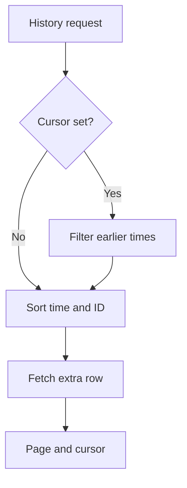

# Raw review — provider: R-NWX · case 01 · condition A
PR: https://github.com/upreti-labs/run-qodo/pull/1 · base pilot/base · head pilot/01 · status in_progress

## Reviews (verbatim, in order received)

### PR comment by qodo-code-review[bot] · 2026-11-23T13:16:54Z

<h3>PR Summary by Qodo</h3>

Page report history by scheduled time


<code>✨ Enhancement</code> <code>🕐 Less than 10 minutes</code>


<details>
<summary>AI Description</summary>

<dl>
<dd>
<br/>

><pre>
>• Show the most recently scheduled deliveries first, with ID breaking ordering ties.
>• Use scheduled time as the cursor for subsequent history pages.
></pre>

</dd>
</dl>

</details>

<!-- qodo-describe-risk-slot --><!-- qodo-describe-risk -->
<!-- qodo-describe-risk-start:1795439842.245353937 -->

<details>
<summary>Merge Risk <code>🟡 Medium</code></summary>

<dl>
<dd>

<br/>

<details>
<summary>Blast radius <code>🟢 Low</code> <code>💥 1 capability</code></summary>

<dl>
<dd>

<br/>

- 1 affected end-to-end capability after fault-specific containment; implementation boundaries do not widen its functional scope.
- This is one bounded operator-facing behavior: retrieving the ordered delivery-history sequence.
- The console invokes reports.history\(\), and the changed SQL determines which records are returned across pages.
- Storage and delivery processing are implementation paths for this same browsing behavior, not independent capabilities.

<details>
<summary>Sources</summary>

<dl>
<dd>

[reports.py\[45-49\]](https://github.com/upreti-labs/run-qodo/blob/b42257746fa78caad922340082a2a27ed00cdeb8/reports.py#L45-L49)

```python
        query += " WHERE scheduled_at < ?"
        params.append(cursor)
    query += " ORDER BY scheduled_at DESC, id DESC LIMIT ?"
    rows = db.execute(query, (*params, limit + 1)).fetchall()
    next_cursor = rows[limit - 1][2] if len(rows) > limit else None
```

</dd>
</dl>

</details>

</dd>
</dl>

</details>
<details>
<summary>Behavioral complexity <code>🟡 Medium</code> <code>🧩 Interacting branches</code></summary>

<dl>
<dd>

<br/>

- Before: pagination used id &lt; cursor with ORDER BY id DESC, so the cursor predicate and ordering shared one strict key.
- After: pagination orders by the compound key scheduled&#95;at DESC, id DESC, but filters only scheduled&#95;at &lt; cursor and emits scheduled&#95;at as the cursor.
- New correctness condition: continuation must preserve the full compound ordering, including the id tie-breaker for deliveries sharing a scheduled&#95;at value.
- The changed behavior therefore introduces an interaction between cursor state, duplicate timestamps, and compound ordering; this is not merely routine reuse of SQLite or existing pagination infrastructure.

<details>
<summary>Sources</summary>

<dl>
<dd>

[reports.py\[45-49\]](https://github.com/upreti-labs/run-qodo/blob/b42257746fa78caad922340082a2a27ed00cdeb8/reports.py#L45-L49)

```python
        query += " WHERE scheduled_at < ?"
        params.append(cursor)
    query += " ORDER BY scheduled_at DESC, id DESC LIMIT ?"
    rows = db.execute(query, (*params, limit + 1)).fetchall()
    next_cursor = rows[limit - 1][2] if len(rows) > limit else None
```

</dd>
</dl>

</details>

</dd>
</dl>

</details>
<details>
<summary>Potential damage <code>🟡 Medium</code> <code>🩹 Incorrect results</code></summary>

<dl>
<dd>

<br/>

- The affected history response can omit valid delivery records when timestamps collide, producing an incomplete browsing result.
- This is limited to the history retrieval capability; no evidence shows that the query mutates deliveries, receipts, scheduling state, exports, or worker behavior.
- Recoverable without persistent state repair or external compensation: rerunning history from the beginning without a cursor, or using a page size that spans the colliding timestamp, can retrieve the records.
- Existing clients following the returned cursor cannot recover the skipped same-timestamp records from that cursor alone and must restart or obtain a corrected cursor/pagination implementation.

<details>
<summary>Sources</summary>

<dl>
<dd>

[reports.py\[45-49\]](https://github.com/upreti-labs/run-qodo/blob/b42257746fa78caad922340082a2a27ed00cdeb8/reports.py#L45-L49)

```python
        query += " WHERE scheduled_at < ?"
        params.append(cursor)
    query += " ORDER BY scheduled_at DESC, id DESC LIMIT ?"
    rows = db.execute(query, (*params, limit + 1)).fetchall()
    next_cursor = rows[limit - 1][2] if len(rows) > limit else None
```

</dd>
</dl>

</details>

</dd>
</dl>

</details>
<sub>Assessed commit <a href="https://github.com/upreti-labs/run-qodo/commit/b42257746fa78caad922340082a2a27ed00cdeb8">b422577</a></sub>


<!-- https://github.com/upreti-labs/run-qodo/commit/b42257746fa78caad922340082a2a27ed00cdeb8 -->
</dd>
</dl>
</details>
<!-- /qodo-describe-risk -->

<details>
<summary>Diagram</summary>

<dl>
<dd>

<br/>



</dd>
</dl>

</details>


<details>
<summary>High-Level Assessment</summary>

<dl>
<dd>

<br/>

>The following are alternative approaches to this PR:

<details>
<summary><b>1. Keep an ID cursor with a timestamp lookup</b></summary>

<dl>
<dd>

- ➕ Preserves the console&#x27;s integer cursor interface.
- ➕ Paginates through deliveries sharing a scheduled time.
- ➖ Requires a lookup to recover the cursor delivery&#x27;s scheduled time.

</dd>
</dl>

</details>

<details>
<summary><b>2. Use a composite time-and-ID cursor</b></summary>

<dl>
<dd>

- ➕ Directly matches the sort order and retains deliveries with equal timestamps.
- ➖ Requires changing cursor encoding and the console&#x27;s integer cursor argument.

</dd>
</dl>

</details>

>**Recommendation:** Prefer an ID cursor with a timestamp lookup and a keyset predicate on both scheduled_at and id. The proposed timestamp-only cursor skips remaining deliveries at the page boundary when multiple reports share a scheduled time, which the application explicitly permits.

</dd>
</dl>

</details>

<details>
<summary> Files changed (1) <code> +3 / -3 </code> </summary>

<dl>
<dd>

<br/>

<details>
<summary>Enhancement (1) <code> +3 / -3 </code></summary>

<dl>
<dd>

<details>
<summary>reports.py<code>Order and page delivery history by scheduled time</code> <code>+3/-3</code></summary>

<br/>

>Order and page delivery history by scheduled time
>
><pre>
>• History now orders by descending scheduled time with ID as a tie-breaker, filters subsequent pages by scheduled time, and returns the last visible row&#x27;s scheduled time as the cursor. The exclusive timestamp filter can skip deliveries tied at a page boundary.
></pre>
>
><a href='https://github.com/upreti-labs/run-qodo/pull/1/files#diff-e09e5408424977efcb04ce4dbf13638058e35f4afb681306bae14985c656d126'>reports.py</a>

</details>

</dd>
</dl>

</details>

</dd>
</dl>

</details>

<!-- qodo-describe-head:b42257746fa78caad922340082a2a27ed00cdeb8 -->

### PR comment by qodo-code-review[bot] · 2026-11-23T13:17:17Z

<h3>Code Review by Qodo</h3>

<br/>


<details>
<summary>  1.  Reports sharing a scheduled time disappear <code>🐞 Bug</code></summary>

<br/>

> <details>
><summary>Description</summary>
><br/>
>
><pre>
><b><i>history()</i></b> orders tied deliveries by <b><i>id</i></b> but filters the next page using only `scheduled_at &lt;
>cursor`. When a page ends partway through a group scheduled for the same second, every remaining
>delivery in that group is excluded from subsequent pages.
></pre>
></details>

> <details>
><summary>Agent prompt</summary>
><br/>
>
>```
>The issue below was found during a code review. Follow the provided context and guidance below and implement a solution
>
>## Issue description
>A timestamp-only cursor skips deliveries that share the timestamp at a page boundary.
>## Fix Focus Areas
>- reports.py[44-50]
>- console.py[24-25]
>## Recommended Fix
>Encode both the scheduled time and delivery ID in the opaque cursor. Decode both for the next request and filter with `(scheduled_at, id) < (?, ?)` to match the descending sort; update console cursor parsing to accept the encoding.
>```
> <code>ⓘ Copy this prompt and use it to remediate the issue with your preferred AI generation tools</code>
></details>

[Dismiss ↗](https://app.qodo.ai/findings/58769dce-e1ca-4fe4-adf0-c5ea3fa61706?action=dismiss&origin=git) | [View ↗](https://app.qodo.ai/findings/58769dce-e1ca-4fe4-adf0-c5ea3fa61706)

</details>


<br/>

<details><summary><ins><strong>View medium (2)</strong></ins></summary><br/>


<details>
<summary>  2.  Existing history cursors end pages early <code>🐞 Bug</code></summary>

<br/>

> <details>
><summary>Description</summary>
><br/>
>
><pre>
><b><i>history()</i></b> now interprets an integer cursor issued as a delivery ID by the previous implementation
>as a Unix timestamp, without identifying or rejecting the old format. If an operator requests the
>next page after deploying this change, an ordinary old ID can produce an empty page even while older
>deliveries remain.
></pre>
></details>

> <details>
><summary>Agent prompt</summary>
><br/>
>
>```
>The issue below was found during a code review. Follow the provided context and guidance below and implement a solution
>
>## Issue description
>Previously issued integer ID cursors are silently treated as scheduled timestamps after deployment.
>## Fix Focus Areas
>- reports.py[44-49]
>- console.py[24-25]
>## Recommended Fix
>Introduce a distinguishable, versioned cursor encoding for the new ordering and explicitly handle or reject legacy integer cursors rather than applying them to `scheduled_at`. Preserve a continuation path for in-flight legacy pages if required.
>```
> <code>ⓘ Copy this prompt and use it to remediate the issue with your preferred AI generation tools</code>
></details>

[Dismiss ↗](https://app.qodo.ai/findings/f0052004-542c-46fa-b191-0c90e67a977e?action=dismiss&origin=git) | [View ↗](https://app.qodo.ai/findings/f0052004-542c-46fa-b191-0c90e67a977e)

</details>


<details>
<summary>  3.  History pages slow as deliveries grow <code>🐞 Bug</code></summary>

<br/>

> <details>
><summary>Description</summary>
><br/>
>
><pre>
><b><i>history()</i></b> now sorts by <b><i>scheduled_at</i></b> without an index on that column, replacing an ID sort
>supported by the deliveries table&#x27;s integer primary key. Each page request must scan and sort
>matching deliveries before applying the limit, so browsing a large history becomes increasingly
>expensive.
></pre>
></details>

> <details>
><summary>Agent prompt</summary>
><br/>
>
>```
>The issue below was found during a code review. Follow the provided context and guidance below and implement a solution
>
>## Issue description
>The changed history ordering has no supporting index and requires sorting deliveries for each page.
>## Fix Focus Areas
>- reports.py[45-48]
>- migrations/001_initial.sql[1-8]
>## Recommended Fix
>Add a new numbered migration creating an index supporting the scheduled-time and ID ordering and pagination predicate. Verify the history query plan uses it for both first and subsequent pages.
>```
> <code>ⓘ Copy this prompt and use it to remediate the issue with your preferred AI generation tools</code>
></details>

[Dismiss ↗](https://app.qodo.ai/findings/f05cadb6-b245-4c5d-9866-c2beb7029df0?action=dismiss&origin=git) | [View ↗](https://app.qodo.ai/findings/f05cadb6-b245-4c5d-9866-c2beb7029df0)

</details>


</details>

<br/>

<!-- qodo-self-review-slot -->
<!-- https://github.com/upreti-labs/run-qodo/commit/b42257746fa78caad922340082a2a27ed00cdeb8 -->

