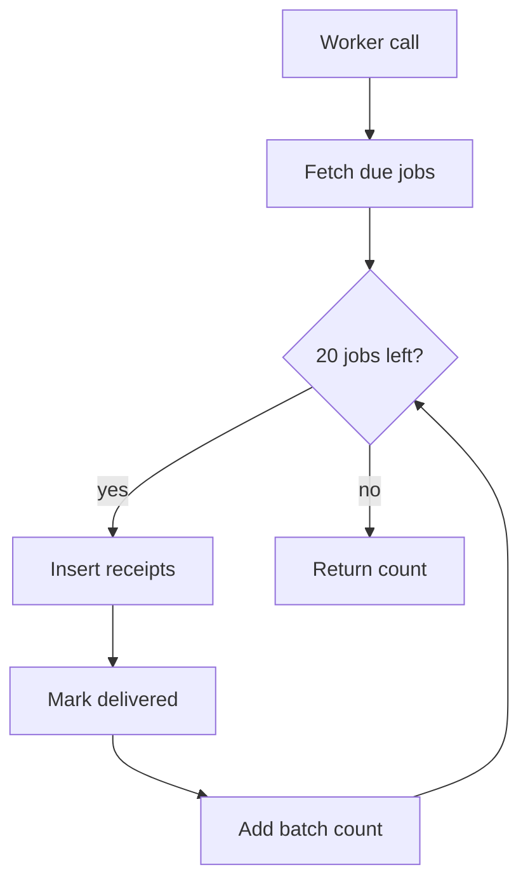

# Raw review — provider: R-NWX · case 03 · condition A
PR: https://github.com/upreti-labs/run-qodo/pull/3 · base pilot/base · head pilot/03 · status in_progress

## Reviews (verbatim, in order received)

### PR comment by qodo-code-review[bot] · 2026-11-23T13:18:18Z

<h3>PR Summary by Qodo</h3>

Batch queued delivery writes


<code>✨ Enhancement</code> <code>🕐 10-20 Minutes</code>


<details>
<summary>AI Description</summary>

<dl>
<dd>
<br/>

><pre>
>• Groups receipt inserts and delivery updates into batches of twenty to reduce per-call overhead.
>• Keeps the writes in one transaction, but currently skips queues with fewer than twenty remaining
>  jobs.
></pre>

</dd>
</dl>

</details>

<!-- qodo-describe-risk-slot --><!-- qodo-describe-risk -->
<!-- qodo-describe-risk-start:1795439928.168370008 -->

<details>
<summary>Merge Risk <code>🟡 Medium</code></summary>

<dl>
<dd>

<br/>

<details>
<summary>Blast radius <code>🟢 Low</code> <code>💥 1 capability</code></summary>

<dl>
<dd>

<br/>

- 1 affected end-to-end capability after fault-specific containment; implementation boundaries do not widen its functional scope.
- Scheduling, queue selection, worker processing, receipt recording, delivered status, and the operator-facing work result form one bounded report-delivery integration.
- The inspected console calls this worker, while the deliveries and receipts tables represent its persistent outcome; these are propagation hops of the same end-to-end behavior rather than independent capabilities.

<details>
<summary>Sources</summary>

<dl>
<dd>

[reports.py\[76-89\]](https://github.com/upreti-labs/run-qodo/blob/6cca1e909a083c5a7f3fefc60ba637c2c84c411c/reports.py#L76-L89)

```python
        processed = 0
        batch_size = 20
        for start in range(0, len(jobs) - batch_size + 1, batch_size):
            batch = jobs[start:start + batch_size]
            db.executemany(
                "INSERT INTO receipts VALUES (?, ?)",
                ((job_id, now) for (job_id,) in batch),
            )
            db.executemany(
                "UPDATE deliveries SET delivered_at = ? WHERE id = ?",
                ((now, job_id) for (job_id,) in batch),
            )
            processed += len(batch)
    return processed
```

</dd>
</dl>

</details>

</dd>
</dl>

</details>
<details>
<summary>Behavioral complexity <code>🟡 Medium</code> <code>🧩 Coordinated invariants</code></summary>

<dl>
<dd>

<br/>

- Before: the worker iterated every selected due job and paired a receipt insert with a delivered&#95;at update.
- After: processing is coordinated through fixed-size batches and two bulk writes per batch.
- New correctness condition: every selected due job, including a final partial batch, must participate in both writes and contribute to processed.
- The batching invariant is not preserved by the loop bound, which only admits complete batches.
- The existing transaction provides atomicity for executed writes but does not contain or repair jobs excluded by the loop.

<details>
<summary>Sources</summary>

<dl>
<dd>

[reports.py\[76-89\]](https://github.com/upreti-labs/run-qodo/blob/6cca1e909a083c5a7f3fefc60ba637c2c84c411c/reports.py#L76-L89)

```python
        processed = 0
        batch_size = 20
        for start in range(0, len(jobs) - batch_size + 1, batch_size):
            batch = jobs[start:start + batch_size]
            db.executemany(
                "INSERT INTO receipts VALUES (?, ?)",
                ((job_id, now) for (job_id,) in batch),
            )
            db.executemany(
                "UPDATE deliveries SET delivered_at = ? WHERE id = ?",
                ((now, job_id) for (job_id,) in batch),
            )
            processed += len(batch)
    return processed
```

</dd>
</dl>

</details>

</dd>
</dl>

</details>
<details>
<summary>Potential damage <code>🟡 Medium</code> <code>🩹 Recoverable</code></summary>

<dl>
<dd>

<br/>

- Due reports in the unprocessed remainder are not delivered and remain pending, so the scheduled report delivery capability is degraded.
- The affected rows are not shown to be corrupted: after correcting the worker, rerunning it can process the still-pending rows.
- Recovery requires code correction and an eligible worker invocation; no automatic repair or retry enforcement was found.
- The equal-importance baseline is used because no business-criticality declaration was supplied.
- Recoverable by deploying the corrected worker and rerunning the worker for the affected queue/time window.
- Reverting or correcting code alone does not deliver already-skipped jobs; the pending state must be processed by a subsequent invocation.

<details>
<summary>Sources</summary>

<dl>
<dd>

[reports.py\[76-89\]](https://github.com/upreti-labs/run-qodo/blob/6cca1e909a083c5a7f3fefc60ba637c2c84c411c/reports.py#L76-L89)

```python
        processed = 0
        batch_size = 20
        for start in range(0, len(jobs) - batch_size + 1, batch_size):
            batch = jobs[start:start + batch_size]
            db.executemany(
                "INSERT INTO receipts VALUES (?, ?)",
                ((job_id, now) for (job_id,) in batch),
            )
            db.executemany(
                "UPDATE deliveries SET delivered_at = ? WHERE id = ?",
                ((now, job_id) for (job_id,) in batch),
            )
            processed += len(batch)
    return processed
```

</dd>
</dl>

</details>

</dd>
</dl>

</details>
<sub>Assessed commit <a href="https://github.com/upreti-labs/run-qodo/commit/6cca1e909a083c5a7f3fefc60ba637c2c84c411c">6cca1e9</a></sub>


<!-- https://github.com/upreti-labs/run-qodo/commit/6cca1e909a083c5a7f3fefc60ba637c2c84c411c -->
</dd>
</dl>
</details>
<!-- /qodo-describe-risk -->

<details>
<summary>Diagram</summary>

<dl>
<dd>

<br/>



</dd>
</dl>

</details>


<details>
<summary>High-Level Assessment</summary>

<dl>
<dd>

<br/>

>The following are alternative approaches to this PR:

<details>
<summary><b>1. Stream fixed-size chunks</b></summary>

<dl>
<dd>

- ➕ Processes the final partial batch.
- ➕ Avoids loading every due ID into memory.
- ➖ Requires a chunk iterator and more restructuring than correcting the current loop.

</dd>
</dl>

</details>

>**Recommendation:** Keep the single-transaction batching approach, but iterate starts through the entire job list so the final partial batch is processed. As written, fewer than twenty due jobs result in no deliveries; add boundary tests before merging. Streaming chunks is worth considering only if queue sizes make fetchall memory use significant.

</dd>
</dl>

</details>

<details>
<summary> Files changed (1) <code> +14 / -4 </code> </summary>

<dl>
<dd>

<br/>

<details>
<summary>Enhancement (1) <code> +14 / -4 </code></summary>

<dl>
<dd>

<details>
<summary>reports.py<code>Batch receipt inserts and delivery updates</code> <code>+14/-4</code></summary>

<br/>

>Batch receipt inserts and delivery updates
>
><pre>
>• Replaces per-job execute calls with executemany calls for groups of twenty and returns a processed counter. The range excludes a final partial group, leaving those jobs undelivered and uncounted.
></pre>
>
><a href='https://github.com/upreti-labs/run-qodo/pull/3/files#diff-e09e5408424977efcb04ce4dbf13638058e35f4afb681306bae14985c656d126'>reports.py</a>

</details>

</dd>
</dl>

</details>

</dd>
</dl>

</details>

<!-- qodo-describe-head:6cca1e909a083c5a7f3fefc60ba637c2c84c411c -->

### PR comment by qodo-code-review[bot] · 2026-11-23T13:18:44Z

<h3>Code Review by Qodo</h3>

<br/>


<details>
<summary>  1.  Small queues never deliver their jobs <code>🐞 Bug</code></summary>

<br/>

> <details>
><summary>Description</summary>
><br/>
>
><pre>
><b><i>deliver_due</i></b> uses a loop bound that processes only complete batches of 20, leaving the final
>partial batch untouched. When fewer than 20 jobs are due—or a larger run leaves a remainder—those
>jobs receive no receipts and remain pending until enough additional jobs become due to fill a batch.
></pre>
></details>

> <details>
><summary>Agent prompt</summary>
><br/>
>
>```
>The issue below was found during a code review. Follow the provided context and guidance below and implement a solution
>
>## Issue description
>The batching loop skips any due jobs that do not fill a batch of 20, so they remain undelivered.
>## Fix Focus Areas
>- reports.py[78-88]
>## Recommended Fix
>Iterate with `range(0, len(jobs), batch_size)` and keep the existing slice and batched writes. Verify that runs with fewer than 20 jobs and with a partial final batch deliver every job and return the full processed count.
>```
> <code>ⓘ Copy this prompt and use it to remediate the issue with your preferred AI generation tools</code>
></details>

[Dismiss ↗](https://app.qodo.ai/findings/158e6740-6ca9-4cbb-b770-b8040e540126?action=dismiss&origin=git) | [View ↗](https://app.qodo.ai/findings/158e6740-6ca9-4cbb-b770-b8040e540126)

</details>


<br/>

<!-- qodo-self-review-slot -->
<!-- https://github.com/upreti-labs/run-qodo/commit/6cca1e909a083c5a7f3fefc60ba637c2c84c411c -->

