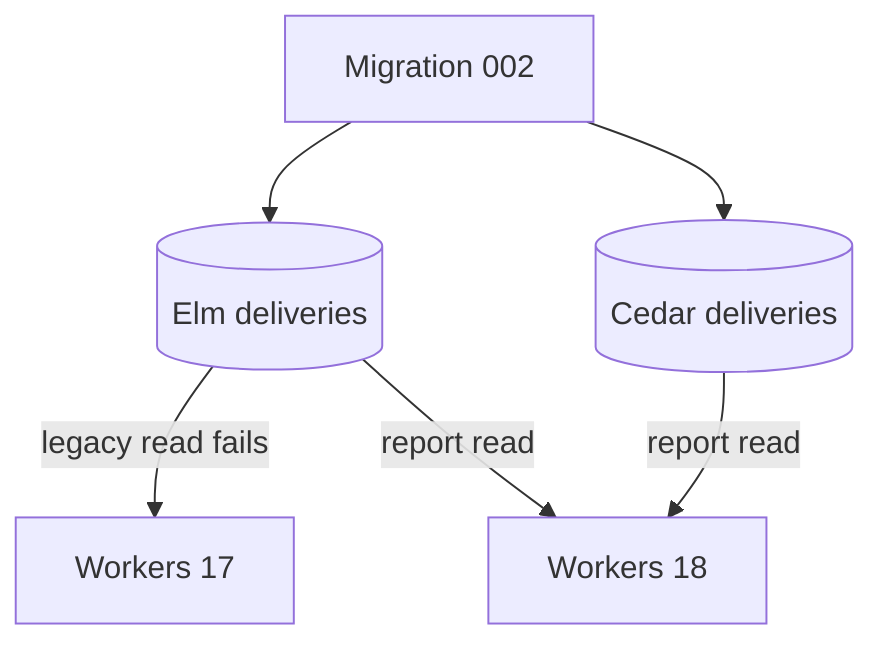

# Raw review — provider: R-NWX · case 04 · condition B
PR: https://github.com/upreti-labs/run-qodo/pull/9 · base pilot/base · head pilot/04 · status in_progress

## Reviews (verbatim, in order received)

### PR comment by qodo-code-review[bot] · 2026-11-23T13:44:37Z

<h3>PR Summary by Qodo</h3>

Retire the legacy delivery column


<code>✨ Enhancement</code> <code>🕐 10-20 Minutes</code>


<details>
<summary>AI Description</summary>

<dl>
<dd>
<br/>

><pre>
>• Adds a migration that drops <b><i>legacy_format</i></b> from each site&#x27;s deliveries table.
>• Elm&#x27;s active workers-17 replicas still select that column and will fail after migration.
></pre>

</dd>
</dl>

</details>

<!-- qodo-describe-risk-slot --><!-- qodo-describe-risk -->
<!-- qodo-describe-risk-start:1795441508.430218935 -->

<details>
<summary>Merge Risk <code>🟡 Medium</code></summary>

<dl>
<dd>

<br/>

<details>
<summary>Blast radius <code>🟢 Low</code> <code>💥 1 capability</code></summary>

<dl>
<dd>

<br/>

- 1 affected end-to-end capability after fault-specific containment; implementation boundaries do not widen its functional scope.
- The migration changes the persistent representation used by the single scheduled-report delivery integration.
- The inspected scheduler, worker, history, export, archive, and summary operations all operate on deliveries, but none consumes legacy&#95;format; they are therefore one bounded end-to-end capability rather than separate technical-layer capabilities.

<details>
<summary>Sources</summary>

<dl>
<dd>

[migrations/002_retire_format.sql\[1-1\]](https://github.com/upreti-labs/run-qodo/blob/420baea889887b127f1c87d99f728e40f7664996/migrations/002_retire_format.sql#L1-L1)

```sql
ALTER TABLE deliveries DROP COLUMN legacy_format;
```

</dd>
</dl>

</details>

</dd>
</dl>

</details>
<details>
<summary>Behavioral complexity <code>🟡 Medium</code> <code>🧩 Compatibility cases</code></summary>

<dl>
<dd>

<br/>

- Before: deliveries contained legacy&#95;format, and migration startup applied numbered schema changes to existing databases.
- After: migration 002 removes the column for every database that reaches that version.
- New correctness condition: all supported producer, reader, queued-work, and rollback states must remain compatible across the old schema and the post-migration schema, while any required legacy metadata must be recoverable or explicitly retired.
- The repository shows no current caller using the field, so the active application path is straightforward; the nontrivial condition is the old/new schema and rollback compatibility transition, not the routine migration helper itself.

<details>
<summary>Sources</summary>

<dl>
<dd>

[migrations/002_retire_format.sql\[1-1\]](https://github.com/upreti-labs/run-qodo/blob/420baea889887b127f1c87d99f728e40f7664996/migrations/002_retire_format.sql#L1-L1)

```sql
ALTER TABLE deliveries DROP COLUMN legacy_format;
```

</dd>
</dl>

</details>

</dd>
</dl>

</details>
<details>
<summary>Potential damage <code>🔴 High</code> <code>🩹 Data loss</code></summary>

<dl>
<dd>

<br/>

- Stored legacy&#95;format values are destroyed by DROP COLUMN and cannot be recovered by reverting application code alone.
- The loss is limited to retired metadata in the inspected application: no current repository consumer uses it, so there is no evidence of incorrect report delivery or loss of the main scheduling capability.
- Reconstructing the values would require a backup or another authoritative source; recreating the column alone would not restore historical values.
- The migration can be prevented on an un-upgraded database, but after execution code rollback does not restore the column or values.
- Recovery requires restoring the database from backup or manually recreating and repopulating the column if an authoritative source exists.
- Current application behavior is otherwise preserved without state repair.

<details>
<summary>Sources</summary>

<dl>
<dd>

[migrations/002_retire_format.sql\[1-1\]](https://github.com/upreti-labs/run-qodo/blob/420baea889887b127f1c87d99f728e40f7664996/migrations/002_retire_format.sql#L1-L1)

```sql
ALTER TABLE deliveries DROP COLUMN legacy_format;
```

</dd>
</dl>

</details>

</dd>
</dl>

</details>
<sub>Assessed commit <a href="https://github.com/upreti-labs/run-qodo/commit/420baea889887b127f1c87d99f728e40f7664996">420baea</a></sub>


<!-- https://github.com/upreti-labs/run-qodo/commit/420baea889887b127f1c87d99f728e40f7664996 -->
</dd>
</dl>
</details>
<!-- /qodo-describe-risk -->

<details>
<summary>Diagram</summary>

<dl>
<dd>

<br/>



</dd>
</dl>

</details>


<details>
<summary>High-Level Assessment</summary>

<dl>
<dd>

<br/>

>The following are alternative approaches to this PR:

<details>
<summary><b>1. Retire old workers before dropping the column</b></summary>

<dl>
<dd>

- ➕ Prevents elm&#x27;s workers-17 polling queries from failing during the online migration.
- ➖ Requires a coordinated worker rollout and confirmation before applying the migration.

</dd>
</dl>

</details>

>**Recommendation:** Do not apply this migration while workers-17 remains active in elm. Replace those replicas with workers that no longer select legacy_format, verify the rollout, then run the migration per site.

</dd>
</dl>

</details>

<details>
<summary> Files changed (1) <code> +1 / -0 </code> </summary>

<dl>
<dd>

<br/>

<details>
<summary>Other (1) <code> +1 / -0 </code></summary>

<dl>
<dd>

<details>
<summary>002_retire_format.sql<code>Drop legacy_format from deliveries</code> <code>+1/-0</code></summary>

<br/>

>Drop legacy_format from deliveries
>
><pre>
>• Adds a numbered SQL migration that removes the legacy_format column. The drop is incompatible with the active workers-17 polling query in elm.
></pre>
>
><a href='https://github.com/upreti-labs/run-qodo/pull/9/files#diff-984c625e04d72999e7dfc1233e28c15cc3ef010f4ae23dbdb769a9bd453ecbae'>migrations/002_retire_format.sql</a>

</details>

</dd>
</dl>

</details>

</dd>
</dl>

</details>

<!-- qodo-describe-head:420baea889887b127f1c87d99f728e40f7664996 -->

### PR comment by qodo-code-review[bot] · 2026-11-23T13:45:04Z

<h3>Code Review by Qodo</h3>

<br/>


<details>
<summary>  1.  Two elm workers fail every delivery poll <code>🐞 Bug</code></summary>

<br/>

> <details>
><summary>Description</summary>
><br/>
>
><pre>
>Migration 002 drops <b><i>legacy_format</i></b> while two active <b><i>elm</i></b> worker replicas still select it in their
>prepared poll query. When the migration runs on elm, each subsequent poll from those replicas fails
>with <b><i>no such column: legacy_format</i></b> until they are upgraded.
></pre>
></details>

> <details>
><summary>Agent prompt</summary>
><br/>
>
>```
>The issue below was found during a code review. Follow the provided context and guidance below and implement a solution
>
>## Issue description
>The supplied pre-migration inventory shows two active elm workers polling `deliveries.legacy_format`. Dropping that column while they run makes every subsequent poll fail.
>
>## Fix Focus Areas
>- migrations/002_retire_format.sql[1-1]
>- reports.py[12-19]
>
>## Recommended Fix
>Do not deploy the drop as an automatically applied migration while those workers remain active. Upgrade or drain every worker that selects `legacy_format`, verify the old revision is absent at each site, and only then deploy the column-drop migration.
>```
> <code>ⓘ Copy this prompt and use it to remediate the issue with your preferred AI generation tools</code>
></details>

[Dismiss ↗](https://app.qodo.ai/findings/e742cb0f-781b-4860-a1a1-9301838442f0?action=dismiss&origin=git) | [View ↗](https://app.qodo.ai/findings/e742cb0f-781b-4860-a1a1-9301838442f0)

</details>


<br/>

<!-- qodo-self-review-slot -->
<!-- https://github.com/upreti-labs/run-qodo/commit/420baea889887b127f1c87d99f728e40f7664996 -->

