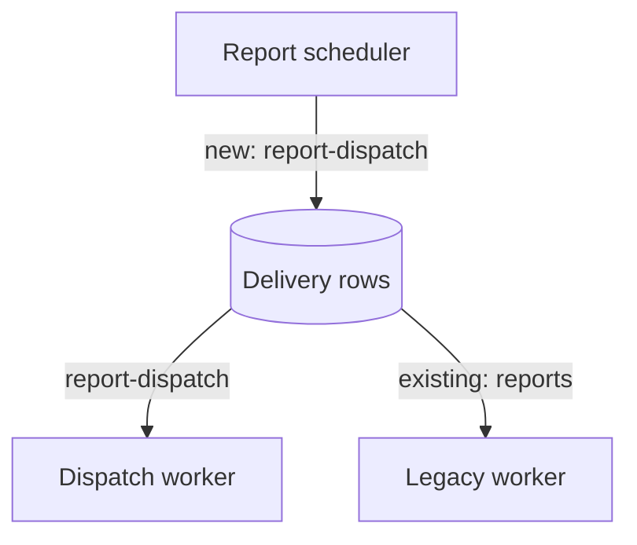

# Raw review — provider: R-NWX · case 06 · condition A
PR: https://github.com/upreti-labs/run-qodo/pull/6 · base pilot/base · head pilot/06 · status completed

## Reviews (verbatim, in order received)

### PR comment by qodo-code-review[bot] · 2026-11-23T13:20:16Z

<h3>PR Summary by Qodo</h3>

Route newly scheduled reports to the dispatch queue


<code>⚙️ Configuration changes</code> <code>🕐 Less than 5 minutes</code>


<details>
<summary>AI Description</summary>

<dl>
<dd>
<br/>

><pre>
>• Assign newly scheduled deliveries to the dedicated report-dispatch queue.
>• Preserve existing jobs’ stored queue assignments so they remain available to their original
>  workers.
></pre>

</dd>
</dl>

</details>

<!-- qodo-describe-risk-slot --><!-- qodo-describe-risk -->
<!-- qodo-describe-risk-start:1795440033.730844975 -->

<details>
<summary>Merge Risk <code>🟢 Low</code></summary>

<dl>
<dd>

<br/>

<details>
<summary>Blast radius <code>🟢 Low</code> <code>💥 1 capability</code></summary>

<dl>
<dd>

<br/>

- 1 affected end-to-end capability after fault-specific containment; implementation boundaries do not widen its functional scope.
- Scheduling and queue-based worker delivery form one bounded end-to-end integration: schedule persists the delivery and deliver&#95;due consumes it.
- The queue field is the propagation boundary between those steps, not an independent capability.
- No separate affected user outcome was found in history, export, archive, or summary; those read the delivery records without depending on this queue value.

<details>
<summary>Sources</summary>

<dl>
<dd>

[reports.py\[9-9\]](https://github.com/upreti-labs/run-qodo/blob/fcb0c2a94196532d3d49af8d99d731474b00c1c2/reports.py#L9-L9)

```python
DELIVERY_QUEUE = "report-dispatch"
```

[reports.py\[23-27\]](https://github.com/upreti-labs/run-qodo/blob/fcb0c2a94196532d3d49af8d99d731474b00c1c2/reports.py#L23-L27)

```python
def schedule(db, report, scheduled_at):
    with db:
        row = db.execute(
            "INSERT INTO deliveries (report, scheduled_at, queue) VALUES (?, ?, ?)",
            (report, scheduled_at, DELIVERY_QUEUE),
```

</dd>
</dl>

</details>

</dd>
</dl>

</details>
<details>
<summary>Behavioral complexity <code>🟢 Low</code> <code>🧩 Straightforward</code></summary>

<dl>
<dd>

<br/>

- Before: schedule stored the queue name expected by the documented worker invocation, reports.
- After: the single queue constant is changed to report-dispatch and is still passed directly into the existing INSERT; deliver&#95;due&#x27;s selection logic is unchanged.
- New correctness condition: the producer&#x27;s persisted queue identifier must remain compatible with the worker invocation&#x27;s queue argument.
- This is a direct routing-value change using unchanged persistence and worker-filtering infrastructure, without newly interacting branches, states, algorithms, or concurrency protocols.

<details>
<summary>Sources</summary>

<dl>
<dd>

[reports.py\[9-9\]](https://github.com/upreti-labs/run-qodo/blob/fcb0c2a94196532d3d49af8d99d731474b00c1c2/reports.py#L9-L9)

```python
DELIVERY_QUEUE = "report-dispatch"
```

[reports.py\[23-27\]](https://github.com/upreti-labs/run-qodo/blob/fcb0c2a94196532d3d49af8d99d731474b00c1c2/reports.py#L23-L27)

```python
def schedule(db, report, scheduled_at):
    with db:
        row = db.execute(
            "INSERT INTO deliveries (report, scheduled_at, queue) VALUES (?, ?, ?)",
            (report, scheduled_at, DELIVERY_QUEUE),
```

[README.md\[7-7\]](https://github.com/upreti-labs/run-qodo/blob/fcb0c2a94196532d3d49af8d99d731474b00c1c2/README.md#L7-L7)

```markdown
python3 console.py work --queue reports --now 1700000001
```

</dd>
</dl>

</details>

</dd>
</dl>

</details>
<details>
<summary>Potential damage <code>🟡 Medium</code> <code>🩹 Temporary loss</code></summary>

<dl>
<dd>

<br/>

- When activated with the documented worker command, newly scheduled reports are not delivered and remain pending.
- This is recoverable because the records and report payload remain in the deliveries table: an operator can invoke the worker with report-dispatch, or manually repair the stored queue value before retrying delivery.
- Reverting code alone does not repair rows already written with report-dispatch, so state repair or an explicitly compatible worker invocation is required.
- No evidence shows loss of report data or irreversible external effects.
- Temporary loss of delivery.
- Recovery requires reaching the pending rows with queue=report-dispatch or repairing their queue values, then running the due-job worker.
- Existing rows with queue=reports remain deliverable through the old invocation; newly written rows do not automatically migrate when code is reverted.

<details>
<summary>Sources</summary>

<dl>
<dd>

[reports.py\[9-9\]](https://github.com/upreti-labs/run-qodo/blob/fcb0c2a94196532d3d49af8d99d731474b00c1c2/reports.py#L9-L9)

```python
DELIVERY_QUEUE = "report-dispatch"
```

[reports.py\[23-27\]](https://github.com/upreti-labs/run-qodo/blob/fcb0c2a94196532d3d49af8d99d731474b00c1c2/reports.py#L23-L27)

```python
def schedule(db, report, scheduled_at):
    with db:
        row = db.execute(
            "INSERT INTO deliveries (report, scheduled_at, queue) VALUES (?, ?, ?)",
            (report, scheduled_at, DELIVERY_QUEUE),
```

[README.md\[7-7\]](https://github.com/upreti-labs/run-qodo/blob/fcb0c2a94196532d3d49af8d99d731474b00c1c2/README.md#L7-L7)

```markdown
python3 console.py work --queue reports --now 1700000001
```

</dd>
</dl>

</details>

</dd>
</dl>

</details>
<sub>Assessed commit <a href="https://github.com/upreti-labs/run-qodo/commit/fcb0c2a94196532d3d49af8d99d731474b00c1c2">fcb0c2a</a></sub>


<!-- https://github.com/upreti-labs/run-qodo/commit/fcb0c2a94196532d3d49af8d99d731474b00c1c2 -->
</dd>
</dl>
</details>
<!-- /qodo-describe-risk -->

<details>
<summary>Diagram</summary>

<dl>
<dd>

<br/>



</dd>
</dl>

</details>


<details>
<summary>High-Level Assessment</summary>

<dl>
<dd>

<br/>

>Changing the scheduling constant is the simplest way to route only future jobs without migrating existing rows. Ensure a worker uses report-dispatch and update the README’s work-command example, which still names reports.

</dd>
</dl>

</details>

<details>
<summary> Files changed (1) <code> +1 / -1 </code> </summary>

<dl>
<dd>

<br/>

<details>
<summary>Other (1) <code> +1 / -1 </code></summary>

<dl>
<dd>

<details>
<summary>reports.py<code>Assign future deliveries to report-dispatch</code> <code>+1/-1</code></summary>

<br/>

>Assign future deliveries to report-dispatch
>
><pre>
>• Changes DELIVERY_QUEUE from reports to report-dispatch. The schedule function writes this value only when inserting a new delivery, so stored assignments remain unchanged.
></pre>
>
><a href='https://github.com/upreti-labs/run-qodo/pull/6/files#diff-e09e5408424977efcb04ce4dbf13638058e35f4afb681306bae14985c656d126'>reports.py</a>

</details>

</dd>
</dl>

</details>

</dd>
</dl>

</details>

<!-- qodo-describe-head:fcb0c2a94196532d3d49af8d99d731474b00c1c2 -->

### PR comment by qodo-code-review[bot] · 2026-11-23T13:20:28Z

<h3>Code Review by Qodo</h3>

<br/>


<details>
<summary>  1.  New deliveries stall unless operators run a new worker <code>🐞 Bug</code></summary>

<br/>

> <details>
><summary>Description</summary>
><br/>
>
><pre>
>Changing <b><i>DELIVERY_QUEUE</i></b> to <b><i>report-dispatch</i></b> makes <b><i>schedule</i></b> write every new job with that queue
>value, and <b><i>deliver_due</i></b> only selects rows whose <b><i>queue</i></b> matches the <b><i>--queue</i></b> argument exactly. The
>repository&#x27;s documented runbook still starts the worker with <b><i>work --queue reports</i></b>, so new jobs are
>never picked up by that command and remain pending with no error. The same stall applies to any
>deployment whose worker is configured only for <b><i>reports</i></b>.
></pre>
></details>

> <details>
><summary>Agent prompt</summary>
><br/>
>
>```
>The issue below was found during a code review. Follow the provided context and guidance below and implement a solution
>
>## Issue description
>After `DELIVERY_QUEUE` changed from `reports` to `report-dispatch`, newly scheduled jobs are stored with the new queue, but the documented and deployed worker command only consumes `reports`. Those jobs never get delivered and stay pending.
>
>## Fix Focus Areas
>- reports.py[9-9]
>- reports.py[16-24]
>- README.md[1-14]
>
>## Recommended Fix
>Add a worker entry for `report-dispatch` to the runbook and to whatever scheduler runs `work --queue reports`, so it runs alongside the existing `reports` worker. Keep the `reports` worker running until all jobs already assigned to it are delivered. Add a test that schedules a job and confirms `deliver_due` delivers it when called with the new queue name.
>```
> <code>ⓘ Copy this prompt and use it to remediate the issue with your preferred AI generation tools</code>
></details>

[Dismiss ↗](https://app.qodo.ai/findings/bc4a3f55-f177-4cc7-8276-b776d3a459b6?action=dismiss&origin=git) | [View ↗](https://app.qodo.ai/findings/bc4a3f55-f177-4cc7-8276-b776d3a459b6)

</details>


<br/>

<!-- qodo-self-review-slot -->
<!-- https://github.com/upreti-labs/run-qodo/commit/fcb0c2a94196532d3d49af8d99d731474b00c1c2 -->

