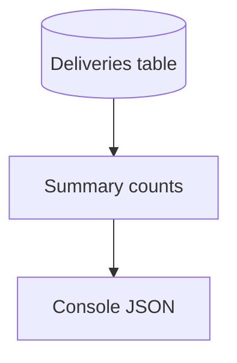

# Raw review — provider: R-NWX · case 08 · condition A
PR: https://github.com/upreti-labs/run-qodo/pull/8 · base pilot/base · head pilot/08 · status in_progress

## Reviews (verbatim, in order received)

### PR comment by qodo-code-review[bot] · 2026-11-23T13:21:22Z

<h3>PR Summary by Qodo</h3>

Include total deliveries in the activity summary


<code>✨ Enhancement</code> <code>🕐 Less than 5 minutes</code>


<details>
<summary>AI Description</summary>

<dl>
<dd>
<br/>

><pre>
>• Add a total delivery count alongside delivered and pending counts.
>• Expose the total through the existing console summary command.
></pre>

</dd>
</dl>

</details>

<!-- qodo-describe-risk-slot --><!-- qodo-describe-risk -->
<!-- qodo-describe-risk-start:1795440094.114406109 -->

<details>
<summary>Merge Risk <code>🟢 Low</code></summary>

<dl>
<dd>

<br/>

<details>
<summary>Blast radius <code>🟢 Low</code> <code>💥 1 capability</code></summary>

<dl>
<dd>

<br/>

- 1 affected end-to-end capability after fault-specific containment; implementation boundaries do not widen its functional scope.
- The changed value is produced by the delivery summary and exposed through the console&#x27;s summary command.
- These are producer and presentation hops of one bounded delivery-reporting behavior, not independent capabilities.

<details>
<summary>Sources</summary>

<dl>
<dd>

[reports.py\[83-86\]](https://github.com/upreti-labs/run-qodo/blob/f869d7c350ead2a39bbb37b1e5b24aa4cbaa790a/reports.py#L83-L86)

```python
    sent, waiting = db.execute(
        "SELECT count(delivered_at), count(*) - count(delivered_at) FROM deliveries"
    ).fetchone()
    return {"delivered": sent, "pending": waiting, "total": sent + waiting}
```

</dd>
</dl>

</details>

</dd>
</dl>

</details>
<details>
<summary>Behavioral complexity <code>🟢 Low</code> <code>🧩 Straightforward</code></summary>

<dl>
<dd>

<br/>

- Before: summary returned delivered and pending counts.
- After: it adds total as sent + waiting.
- New correctness condition: total must equal the number of delivery rows represented by the two existing mutually exhaustive counts.
- This is a direct arithmetic derivation using the unchanged query and introduces no new branches, states, ordering, persistence, compatibility protocol, or coordination invariant.

<details>
<summary>Sources</summary>

<dl>
<dd>

[reports.py\[83-86\]](https://github.com/upreti-labs/run-qodo/blob/f869d7c350ead2a39bbb37b1e5b24aa4cbaa790a/reports.py#L83-L86)

```python
    sent, waiting = db.execute(
        "SELECT count(delivered_at), count(*) - count(delivered_at) FROM deliveries"
    ).fetchone()
    return {"delivered": sent, "pending": waiting, "total": sent + waiting}
```

</dd>
</dl>

</details>

</dd>
</dl>

</details>
<details>
<summary>Potential damage <code>🟢 Low</code> <code>🩹 Reversible</code></summary>

<dl>
<dd>

<br/>

- A wrong total would mislead an operator or an external summary consumer, but it would not corrupt deliveries, receipts, or other persistent state.
- Reverting or correcting the code restores subsequent summaries; any already-exported incorrect summaries would need to be rerun, and external consumers that cached the value would need to refresh.
- Business importance uses the required equal-importance baseline because no business criticality declaration was supplied.
- Fully recoverable by rerunning the summary after code correction.
- No database repair or external-effect compensation is required by this change.

<details>
<summary>Sources</summary>

<dl>
<dd>

[reports.py\[83-86\]](https://github.com/upreti-labs/run-qodo/blob/f869d7c350ead2a39bbb37b1e5b24aa4cbaa790a/reports.py#L83-L86)

```python
    sent, waiting = db.execute(
        "SELECT count(delivered_at), count(*) - count(delivered_at) FROM deliveries"
    ).fetchone()
    return {"delivered": sent, "pending": waiting, "total": sent + waiting}
```

</dd>
</dl>

</details>

</dd>
</dl>

</details>
<sub>Assessed commit <a href="https://github.com/upreti-labs/run-qodo/commit/f869d7c350ead2a39bbb37b1e5b24aa4cbaa790a">f869d7c</a></sub>


<!-- https://github.com/upreti-labs/run-qodo/commit/f869d7c350ead2a39bbb37b1e5b24aa4cbaa790a -->
</dd>
</dl>
</details>
<!-- /qodo-describe-risk -->

<details>
<summary>Diagram</summary>

<dl>
<dd>

<br/>



</dd>
</dl>

</details>


<details>
<summary>High-Level Assessment</summary>

<dl>
<dd>

<br/>

>Deriving the total from the counts already returned by the query is the simplest approach. Selecting count(*) separately would change the query without adding useful capability.

</dd>
</dl>

</details>

<details>
<summary> Files changed (1) <code> +1 / -1 </code> </summary>

<dl>
<dd>

<br/>

<details>
<summary>Enhancement (1) <code> +1 / -1 </code></summary>

<dl>
<dd>

<details>
<summary>reports.py<code>Add total to the delivery summary</code> <code>+1/-1</code></summary>

<br/>

>Add total to the delivery summary
>
><pre>
>• The summary response now includes &#x27;total&#x27;, calculated as delivered plus pending. The existing count query and its delivered and pending fields remain unchanged.
></pre>
>
><a href='https://github.com/upreti-labs/run-qodo/pull/8/files#diff-e09e5408424977efcb04ce4dbf13638058e35f4afb681306bae14985c656d126'>reports.py</a>

</details>

</dd>
</dl>

</details>

</dd>
</dl>

</details>

<!-- qodo-describe-head:f869d7c350ead2a39bbb37b1e5b24aa4cbaa790a -->

### PR comment by qodo-code-review[bot] · 2026-11-23T13:21:30Z


<h3>Code Review by Qodo</h3>
<code>🐞 Bugs (0)</code>  <code>📘 Rule violations (0)</code>  <code>📎 Requirement gaps (0)</code>

<br/>


<h3>Great, no issues found!</h3>
Qodo reviewed your code and found no material issues that require review

<br/>


<!-- https://github.com/upreti-labs/run-qodo/commit/f869d7c350ead2a39bbb37b1e5b24aa4cbaa790a -->

<a href="https://www.qodo.ai"></a>
