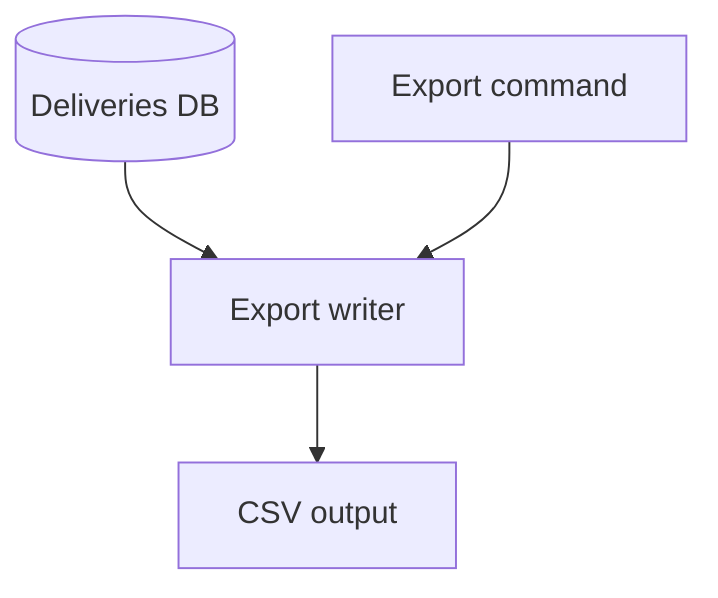

# Raw review — provider: qodo · case 02 · condition A
PR: https://github.com/upreti-labs/run-qodo/pull/2 · base pilot/base · head pilot/02 · status in_progress

## Reviews (verbatim, in order received)

### PR comment by qodo-code-review[bot] · 2026-11-23T13:17:32Z

<h3>PR Summary by Qodo</h3>

Stream report exports from the database cursor


<code>✨ Enhancement</code> <code>🕐 Less than 10 minutes</code>


<details>
<summary>AI Description</summary>

<dl>
<dd>
<br/>

><pre>
>• Export deliveries as the database cursor yields them, avoiding a full in-memory result set.
>• Replace CSV writer output with manual row formatting, changing how special characters are handled.
></pre>

</dd>
</dl>

</details>

<!-- qodo-describe-risk-slot --><!-- qodo-describe-risk -->
<!-- qodo-describe-risk-start:1795439895.811944962 -->

<details>
<summary>Merge Risk <code>🟡 Medium</code></summary>

<dl>
<dd>

<br/>

<details>
<summary>Blast radius <code>🟢 Low</code> <code>💥 1 capability</code></summary>

<dl>
<dd>

<br/>

- 1 affected end-to-end capability after fault-specific containment; implementation boundaries do not widen its functional scope.
- This is one bounded end-to-end behavior: the export command reads delivery records and emits the report archive/export stream.
- The changed serializer and its CLI caller implement the same user-visible export outcome; no separate capability is established for the database query or stdout transport.

<details>
<summary>Sources</summary>

<dl>
<dd>

[reports.py\[52-56\]](https://github.com/upreti-labs/run-qodo/blob/9d551b83dc3a9b0c30868859ea97feef934e7b9b/reports.py#L52-L56)

```python
def write_export(db, output):
    output.write("id,report,scheduled_at\n")
    rows = db.execute("SELECT id, report, scheduled_at FROM deliveries ORDER BY id")
    for row in rows:
        output.write(",".join(map(str, row)) + "\n")
```

</dd>
</dl>

</details>

</dd>
</dl>

</details>
<details>
<summary>Behavioral complexity <code>🟡 Medium</code> <code>🧩 Data transformation</code></summary>

<dl>
<dd>

<br/>

- Before, the established CSV writer handled field quoting and escaping.
- After, the changed logic performs direct string concatenation.
- The new correctness condition is that every report value must be encoded as a valid CSV field, including delimiter, quote, and newline handling; the changed code does not establish that condition.
- This is a changed data transformation requirement, not complexity inherited from the unchanged database query or CLI plumbing.

<details>
<summary>Sources</summary>

<dl>
<dd>

[reports.py\[52-56\]](https://github.com/upreti-labs/run-qodo/blob/9d551b83dc3a9b0c30868859ea97feef934e7b9b/reports.py#L52-L56)

```python
def write_export(db, output):
    output.write("id,report,scheduled_at\n")
    rows = db.execute("SELECT id, report, scheduled_at FROM deliveries ORDER BY id")
    for row in rows:
        output.write(",".join(map(str, row)) + "\n")
```

</dd>
</dl>

</details>

</dd>
</dl>

</details>
<details>
<summary>Potential damage <code>🟡 Medium</code> <code>🩹 Recoverable</code></summary>

<dl>
<dd>

<br/>

- The immediate capability is an unusable or semantically incorrect export for affected report values, rather than corruption of the source database.
- Recovery requires regenerating the export with a correct CSV serializer; any consumer that accepted shifted fields may additionally require re-import or manual correction.
- The equal-importance baseline is used because no business criticality declaration was supplied.
- Source delivery records remain stored, so code rollback or a serializer fix permits regeneration.
- Recovery is not automatic, and external effects from consumers that already imported malformed rows are not repaired by reverting code alone.

<details>
<summary>Sources</summary>

<dl>
<dd>

[reports.py\[52-56\]](https://github.com/upreti-labs/run-qodo/blob/9d551b83dc3a9b0c30868859ea97feef934e7b9b/reports.py#L52-L56)

```python
def write_export(db, output):
    output.write("id,report,scheduled_at\n")
    rows = db.execute("SELECT id, report, scheduled_at FROM deliveries ORDER BY id")
    for row in rows:
        output.write(",".join(map(str, row)) + "\n")
```

</dd>
</dl>

</details>

</dd>
</dl>

</details>
<sub>Assessed commit <a href="https://github.com/upreti-labs/run-qodo/commit/9d551b83dc3a9b0c30868859ea97feef934e7b9b">9d551b8</a></sub>


<!-- https://github.com/upreti-labs/run-qodo/commit/9d551b83dc3a9b0c30868859ea97feef934e7b9b -->
</dd>
</dl>
</details>
<!-- /qodo-describe-risk -->

<details>
<summary>Diagram</summary>

<dl>
<dd>

<br/>



</dd>
</dl>

</details>


<details>
<summary>High-Level Assessment</summary>

<dl>
<dd>

<br/>

>The following are alternative approaches to this PR:

<details>
<summary><b>1. Keep csv.writer and iterate the cursor</b></summary>

<dl>
<dd>

- ➕ Streams rows without loading the full result set.
- ➕ Preserves CSV quoting and escaping for report names containing commas, quotes, or newlines.
- ➖ Retains the CSV library dependency and its existing line-ending behavior.

</dd>
</dl>

</details>

>**Recommendation:** Iterate the database cursor directly, but keep csv.writer for output. The proposed cursor iteration achieves the memory goal; manual comma joining introduces a CSV correctness regression.

</dd>
</dl>

</details>

<details>
<summary> Files changed (1) <code> +3 / -5 </code> </summary>

<dl>
<dd>

<br/>

<details>
<summary>Enhancement (1) <code> +3 / -5 </code></summary>

<dl>
<dd>

<details>
<summary>reports.py<code>Stream export rows instead of fetching all deliveries</code> <code>+3/-5</code></summary>

<br/>

>Stream export rows instead of fetching all deliveries
>
><pre>
>• The export now iterates the database cursor and writes each row to the output stream, removing the full-result fetch. It also replaces csv.writer with comma joining, which no longer escapes CSV-special characters in report names.
></pre>
>
><a href='https://github.com/upreti-labs/run-qodo/pull/2/files#diff-e09e5408424977efcb04ce4dbf13638058e35f4afb681306bae14985c656d126'>reports.py</a>

</details>

</dd>
</dl>

</details>

</dd>
</dl>

</details>

<!-- qodo-describe-head:9d551b83dc3a9b0c30868859ea97feef934e7b9b -->

### PR comment by qodo-code-review[bot] · 2026-11-23T13:18:11Z

<h3>Code Review by Qodo</h3>

<br/>


<details>
<summary>  1.  Report names break the CSV export <code>🐞 Bug</code></summary>

<br/>

> <details>
><summary>Description</summary>
><br/>
>
><pre>
><b><i>write_export</i></b> replaces CSV field encoding with a bare comma join, so report names containing commas
>or newlines are not escaped. Operators can schedule arbitrary report names, and exporting one of
>these names produces rows that CSV readers split into extra fields or records.
></pre>
></details>

> <details>
><summary>Agent prompt</summary>
><br/>
>
>```
>The issue below was found during a code review. Follow the provided context and guidance below and implement a solution
>
>## Issue description
>The export writes database rows without CSV quoting, corrupting records whose report names contain commas or newlines.
>## Fix Focus Areas
>- reports.py[53-56]
>## Recommended Fix
>Restore `csv.writer` for the header and each row, but retain iteration over the database cursor instead of calling `fetchall()`.
>```
> <code>ⓘ Copy this prompt and use it to remediate the issue with your preferred AI generation tools</code>
></details>

[Dismiss ↗](https://app.qodo.ai/findings/4e944b03-d21e-4a08-a61f-28995f479751?action=dismiss&origin=git) | [View ↗](https://app.qodo.ai/findings/4e944b03-d21e-4a08-a61f-28995f479751)

</details>


<br/>

<!-- qodo-self-review-slot -->
<!-- https://github.com/upreti-labs/run-qodo/commit/9d551b83dc3a9b0c30868859ea97feef934e7b9b -->

