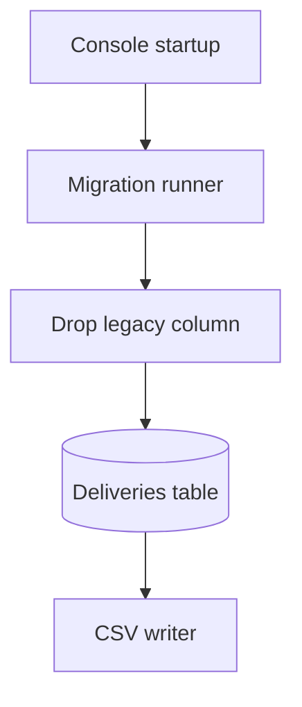

# Raw review — provider: qodo · case 04 · condition A
PR: https://github.com/upreti-labs/run-qodo/pull/4 · base pilot/base · head pilot/04 · status completed

## Reviews (verbatim, in order received)

### PR comment by qodo-code-review[bot] · 2026-11-23T13:19:02Z

<h3>PR Summary by Qodo</h3>

Remove the legacy delivery format column


<code>✨ Enhancement</code> <code>🕐 Less than 10 minutes</code>


<details>
<summary>AI Description</summary>

<dl>
<dd>
<br/>

><pre>
>• Drop the unused <b><i>legacy_format</i></b> column from existing deliveries tables.
>• Keep exports on the CSV writer, which reads only the remaining delivery fields.
></pre>

</dd>
</dl>

</details>

<!-- qodo-describe-risk-slot --><!-- qodo-describe-risk -->
<!-- qodo-describe-risk-start:1795439968.035299063 -->

<details>
<summary>Merge Risk <code>🟢 Low</code></summary>

<dl>
<dd>

<br/>

<details>
<summary>Blast radius <code>🟢 Low</code> <code>💥 1 capability</code></summary>

<dl>
<dd>

<br/>

- 1 affected end-to-end capability after fault-specific containment; implementation boundaries do not widen its functional scope.
- The changed migration and its startup caller participate in one bounded scheduled-report persistence integration.
- The repository&#x27;s schedule, delivery, history, export, archive, and summary operations all use the deliveries table, while the inspected queries do not use legacy&#95;format; no independent functional scope is evidenced.

<details>
<summary>Sources</summary>

<dl>
<dd>

[migrations/002_retire_format.sql\[1-1\]](https://github.com/upreti-labs/run-qodo/blob/420baea889887b127f1c87d99f728e40f7664996/migrations/002_retire_format.sql#L1-L1)

```sql
ALTER TABLE deliveries DROP COLUMN legacy_format;
```

[migrations/001_initial.sql\[1-8\]](https://github.com/upreti-labs/run-qodo/blob/420baea889887b127f1c87d99f728e40f7664996/migrations/001_initial.sql#L1-L8)

```sql
CREATE TABLE deliveries (
    id INTEGER PRIMARY KEY,
    report TEXT NOT NULL,
    scheduled_at INTEGER NOT NULL,
    queue TEXT NOT NULL,
    legacy_format TEXT NOT NULL DEFAULT 'csv',
    delivered_at INTEGER
);
```

</dd>
</dl>

</details>

</dd>
</dl>

</details>
<details>
<summary>Behavioral complexity <code>🟢 Low</code> <code>🧩 Straightforward</code></summary>

<dl>
<dd>

<br/>

- Before: migration 001 creates legacy&#95;format with a default, but the inspected application paths do not consume it.
- After: migration 002 removes that single column through the existing numbered migration runner.
- The new correctness condition is that supported databases must not have remaining dependencies on the column when migration 002 executes.
- This is a direct schema transformation using unchanged migration/version-handling infrastructure; no newly interacting branches, concurrency protocol, algorithm, or coordinated invariant is introduced.

<details>
<summary>Sources</summary>

<dl>
<dd>

[migrations/002_retire_format.sql\[1-1\]](https://github.com/upreti-labs/run-qodo/blob/420baea889887b127f1c87d99f728e40f7664996/migrations/002_retire_format.sql#L1-L1)

```sql
ALTER TABLE deliveries DROP COLUMN legacy_format;
```

[migrations/001_initial.sql\[1-8\]](https://github.com/upreti-labs/run-qodo/blob/420baea889887b127f1c87d99f728e40f7664996/migrations/001_initial.sql#L1-L8)

```sql
CREATE TABLE deliveries (
    id INTEGER PRIMARY KEY,
    report TEXT NOT NULL,
    scheduled_at INTEGER NOT NULL,
    queue TEXT NOT NULL,
    legacy_format TEXT NOT NULL DEFAULT 'csv',
    delivered_at INTEGER
);
```

</dd>
</dl>

</details>

</dd>
</dl>

</details>
<details>
<summary>Potential damage <code>🟡 Medium</code> <code>🩹 Temporary loss</code></summary>

<dl>
<dd>

<br/>

- A dependency-related migration exception can prevent the console command from starting, temporarily removing the requested report operation until the dependency is removed or the database is repaired.
- If the column is dropped successfully and an external consumer still depends on it, reverting application code does not restore the column or its historical values; recovery requires a backup or manual schema/data restoration.
- For the checked-in application, the column is not referenced by the schedule insertion or other inspected report queries, so no concrete user-facing failure is evidenced.
- Business importance uses the required equal-importance baseline; no declared criticality map was supplied.
- Potentially recoverable by restoring the database backup or removing/updating the undeclared dependency and rerunning the migration.
- A successful destructive migration requires explicit schema/data restoration for rollback; automatic retry or repair invocation is not present.

<details>
<summary>Sources</summary>

<dl>
<dd>

[migrations/002_retire_format.sql\[1-1\]](https://github.com/upreti-labs/run-qodo/blob/420baea889887b127f1c87d99f728e40f7664996/migrations/002_retire_format.sql#L1-L1)

```sql
ALTER TABLE deliveries DROP COLUMN legacy_format;
```

</dd>
</dl>

</details>

</dd>
</dl>

</details>
<sub>Assessed commit <a href="https://github.com/upreti-labs/run-qodo/commit/420baea889887b127f1c87d99f728e40f7664996">420baea</a></sub>


<!-- https://github.com/upreti-labs/run-qodo/commit/420baea889887b127f1c87d99f728e40f7664996 -->
</dd>
</dl>
</details>
<!-- /qodo-describe-risk -->

<details>
<summary>Diagram</summary>

<dl>
<dd>

<br/>



</dd>
</dl>

</details>


<details>
<summary>High-Level Assessment</summary>

<dl>
<dd>

<br/>

>Use the numbered DROP COLUMN migration: the application already applies migrations on startup, its queries do not use legacy_format, and the documented SQLite minimum supports DROP COLUMN. A table rebuild would add complexity without a compatibility benefit.

</dd>
</dl>

</details>

<details>
<summary> Files changed (1) <code> +1 / -0 </code> </summary>

<dl>
<dd>

<br/>

<details>
<summary>Refactor (1) <code> +1 / -0 </code></summary>

<dl>
<dd>

<details>
<summary>002_retire_format.sql<code>Remove legacy_format from deliveries</code> <code>+1/-0</code></summary>

<br/>

>Remove legacy_format from deliveries
>
><pre>
>• Adds a numbered migration that drops the legacy_format column from existing deliveries tables. No application query changes are needed because exports already select fields explicitly.
></pre>
>
><a href='https://github.com/upreti-labs/run-qodo/pull/4/files#diff-984c625e04d72999e7dfc1233e28c15cc3ef010f4ae23dbdb769a9bd453ecbae'>migrations/002_retire_format.sql</a>

</details>

</dd>
</dl>

</details>

</dd>
</dl>

</details>

<!-- qodo-describe-head:420baea889887b127f1c87d99f728e40f7664996 -->

### PR comment by qodo-code-review[bot] · 2026-11-23T13:19:24Z


<h3>Code Review by Qodo</h3>
<code>🐞 Bugs (0)</code>  <code>📘 Rule violations (0)</code>  <code>📎 Requirement gaps (0)</code>

<br/>


<h3>Great, no issues found!</h3>
Qodo reviewed your code and found no material issues that require review

<br/>


<!-- https://github.com/upreti-labs/run-qodo/commit/420baea889887b127f1c87d99f728e40f7664996 -->

<a href="https://www.qodo.ai"></a>
