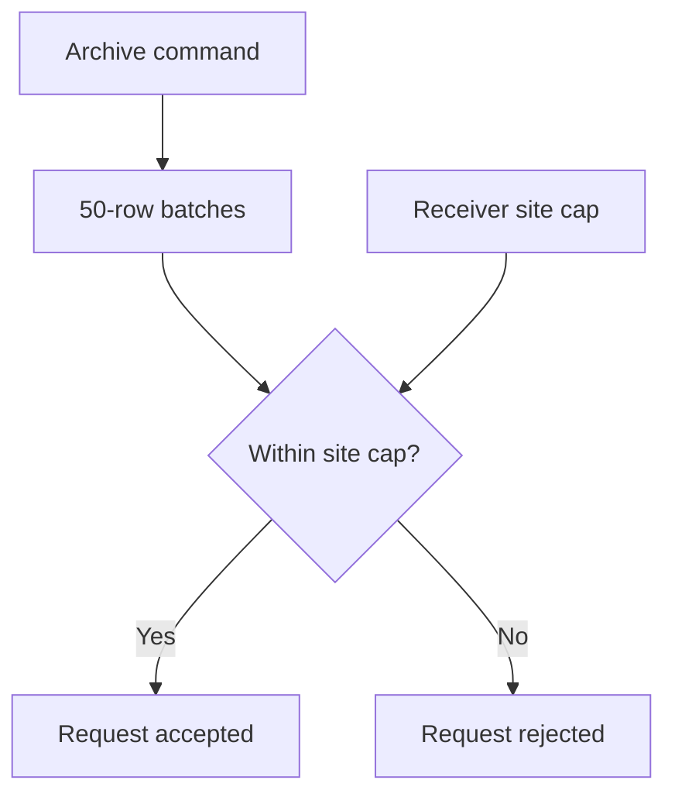

# Raw review — provider: qodo · case 05 · condition B
PR: https://github.com/upreti-labs/run-qodo/pull/10 · base pilot/base · head pilot/05 · status in_progress

## Reviews (verbatim, in order received)

### PR comment by qodo-code-review[bot] · 2026-11-23T13:45:56Z

<h3>PR Summary by Qodo</h3>

Increase archive export batches from 25 to 50 rows


<code>✨ Enhancement</code> <code>⚙️ Configuration changes</code> <code>🕐 Less than 10 minutes</code>


<details>
<summary>AI Description</summary>

<dl>
<dd>
<br/>

><pre>
>• Raise archive export batches from 25 to 50 records per request.
>• Reduce request counts for full exports without changing CSV export behavior.
></pre>

</dd>
</dl>

</details>

<!-- qodo-describe-risk-slot --><!-- qodo-describe-risk -->
<!-- qodo-describe-risk-start:1795441591.518387079 -->

<details>
<summary>Merge Risk <code>🟢 Low</code></summary>

<dl>
<dd>

<br/>

<details>
<summary>Blast radius <code>🟢 Low</code> <code>💥 1 capability</code></summary>

<dl>
<dd>

<br/>

- 1 affected end-to-end capability after fault-specific containment; implementation boundaries do not widen its functional scope.
- The changed constant directly controls the end-to-end archive operation implemented by export&#95;to&#95;sink.
- The database query supplies deliveries and the callback is the terminal archive/output boundary; these are implementation hops of one archive behavior, not independent capabilities.
- No other affected functional scope was found in the inspected callers and documentation.

<details>
<summary>Sources</summary>

<dl>
<dd>

[reports.py\[10-10\]](https://github.com/upreti-labs/run-qodo/blob/1f6f2a4d891c1481ae09c816fac4edcf361c45f1/reports.py#L10-L10)

```python
EXPORT_BATCH_SIZE = 50
```

</dd>
</dl>

</details>

</dd>
</dl>

</details>
<details>
<summary>Behavioral complexity <code>🟢 Low</code> <code>🧩 Straightforward</code></summary>

<dl>
<dd>

<br/>

- Before: export&#95;to&#95;sink used the existing islice-based batching pipeline with a batch-size constant of 25.
- After: the same unchanged iterator, query, loop, and callback invocation use the constant value 50.
- The changed correctness condition is only the selected maximum number of rows per request; no new branch interaction, state transition, algorithm, concurrency protocol, or coordinated invariant is introduced.

<details>
<summary>Sources</summary>

<dl>
<dd>

[reports.py\[10-10\]](https://github.com/upreti-labs/run-qodo/blob/1f6f2a4d891c1481ae09c816fac4edcf361c45f1/reports.py#L10-L10)

```python
EXPORT_BATCH_SIZE = 50
```

</dd>
</dl>

</details>

</dd>
</dl>

</details>
<details>
<summary>Potential damage <code>🟡 Medium</code> <code>🩹 Recoverable</code></summary>

<dl>
<dd>

<br/>

- A rejecting archive request can make the archive operation unavailable for the affected invocation, but export&#95;to&#95;sink does not update deliveries or receipts, so the source records remain available for a later retry.
- Recovery requires changing the batch size or using a compatible sink and rerunning the archive operation.
- If a sink partially accepts a batch before failure, duplicate or reconciliation work is possible, but that external behavior is not established by this repository and is retained as an assumption rather than classified as a separate severe consequence.
- Recoverable by retrying with a compatible callback or reverting the batch-size change.
- Code rollback alone does not undo any external partial processing; such effects would require sink-side deduplication or manual reconciliation if they occur.

<details>
<summary>Sources</summary>

<dl>
<dd>

[reports.py\[10-10\]](https://github.com/upreti-labs/run-qodo/blob/1f6f2a4d891c1481ae09c816fac4edcf361c45f1/reports.py#L10-L10)

```python
EXPORT_BATCH_SIZE = 50
```

</dd>
</dl>

</details>

</dd>
</dl>

</details>
<sub>Assessed commit <a href="https://github.com/upreti-labs/run-qodo/commit/1f6f2a4d891c1481ae09c816fac4edcf361c45f1">1f6f2a4</a></sub>


<!-- https://github.com/upreti-labs/run-qodo/commit/1f6f2a4d891c1481ae09c816fac4edcf361c45f1 -->
</dd>
</dl>
</details>
<!-- /qodo-describe-risk -->

<details>
<summary>Diagram</summary>

<dl>
<dd>

<br/>



</dd>
</dl>

</details>


<details>
<summary>High-Level Assessment</summary>

<dl>
<dd>

<br/>

>The following are alternative approaches to this PR:

<details>
<summary><b>1. Bound batches by each site&#x27;s receiver limit</b></summary>

<dl>
<dd>

- ➕ Retains larger batches at elm without exceeding cedar&#x27;s 40-row limit.
- ➕ Avoids rejection of an entire oversized request.
- ➖ Requires a reliable way to supply the destination site&#x27;s current limit to the exporter.

</dd>
</dl>

</details>

>**Recommendation:** Do not use an unconditional 50-row batch at cedar: its 40-row limit rejects the first request for the stated 70 ready rows. Prefer a site-aware cap before deploying this optimization across both sites.

</dd>
</dl>

</details>

<details>
<summary> Files changed (1) <code> +1 / -1 </code> </summary>

<dl>
<dd>

<br/>

<details>
<summary>Other (1) <code> +1 / -1 </code></summary>

<dl>
<dd>

<details>
<summary>reports.py<code>Raise the archive export batch size to 50</code> <code>+1/-1</code></summary>

<br/>

>Raise the archive export batch size to 50
>
><pre>
>• Changes EXPORT_BATCH_SIZE from 25 to 50, so export_to_sink sends up to 50 records per request. This reduces calls for compatible receivers, but a full batch exceeds cedar&#x27;s stated 40-row limit; the file adds no site-specific cap.
></pre>
>
><a href='https://github.com/upreti-labs/run-qodo/pull/10/files#diff-e09e5408424977efcb04ce4dbf13638058e35f4afb681306bae14985c656d126'>reports.py</a>

</details>

</dd>
</dl>

</details>

</dd>
</dl>

</details>

<!-- qodo-describe-head:1f6f2a4d891c1481ae09c816fac4edcf361c45f1 -->

### PR comment by qodo-code-review[bot] · 2026-11-23T13:46:27Z

<h3>Code Review by Qodo</h3>

<br/>


<details>
<summary>  1.  Cedar&#x27;s archive rejects 50-row batches <code>🐞 Bug</code></summary>

<br/>

> <details>
><summary>Description</summary>
><br/>
>
><pre>
><b><i>EXPORT_BATCH_SIZE = 50</i></b> makes <b><i>export_to_sink</i></b> send up to 50 rows in a single archive request,
>exceeding cedar&#x27;s stated 40-row receiver limit. At the described cutover, cedar has 70 ready rows,
>so its first request is rejected in full and the archive cannot complete successfully; the previous
>25-row batches all fit.
></pre>
></details>

> <details>
><summary>Agent prompt</summary>
><br/>
>
>```
>The issue below was found during a code review. Follow the provided context and guidance below and implement a solution
>
>## Issue description
>The new 50-row batch exceeds cedar's 40-row per-request limit, so its first request for the 70-row archive is rejected.
>
>## Fix Focus Areas
>- reports.py[10-10]
>- reports.py[61-65]
>
>## Recommended Fix
>Cap the shared batch size at 40, which stays within both stated receiver limits while reducing the number of requests compared with 25. If batch sizes must differ by site, pass a receiver-specific limit into the batching function instead.
>```
> <code>ⓘ Copy this prompt and use it to remediate the issue with your preferred AI generation tools</code>
></details>

[Dismiss ↗](https://app.qodo.ai/findings/76a230e0-ee38-4d4e-8c5a-ab0aa4bae09d?action=dismiss&origin=git) | [View ↗](https://app.qodo.ai/findings/76a230e0-ee38-4d4e-8c5a-ab0aa4bae09d)

</details>


<br/>

<!-- qodo-self-review-slot -->
<!-- https://github.com/upreti-labs/run-qodo/commit/1f6f2a4d891c1481ae09c816fac4edcf361c45f1 -->

