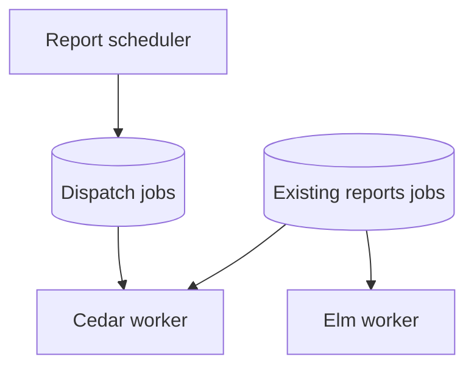

# Raw review — provider: qodo · case 06 · condition B
PR: https://github.com/upreti-labs/run-qodo/pull/11 · base pilot/base · head pilot/06 · status in_progress

## Reviews (verbatim, in order received)

### PR comment by qodo-code-review[bot] · 2026-11-23T13:46:41Z

<h3>PR Summary by Qodo</h3>

Route new report deliveries to the dispatch queue


<code>⚙️ Configuration changes</code> <code>✨ Enhancement</code> <code>🕐 Less than 10 minutes</code>


<details>
<summary>AI Description</summary>

<dl>
<dd>
<br/>

><pre>
>• Route newly scheduled deliveries to <b><i>report-dispatch</i></b> instead of <b><i>reports</i></b>.
>• Preserve existing jobs’ queues; Elm needs a dispatch subscriber before cutover.
></pre>

</dd>
</dl>

</details>

<!-- qodo-describe-risk-slot --><!-- qodo-describe-risk -->
<!-- qodo-describe-risk-start:1795441669.532855988 -->

<details>
<summary>Merge Risk <code>🟡 Medium</code></summary>

<dl>
<dd>

<br/>

<details>
<summary>Blast radius <code>🟢 Low</code> <code>💥 0 capabilities</code></summary>

<dl>
<dd>

<br/>

- Fault-specific containment limits risk to the originating changed behavior.


</dd>
</dl>

</details>
<details>
<summary>Behavioral complexity <code>🟡 Medium</code> <code>🧩 Compatibility cases</code></summary>

<dl>
<dd>

<br/>

- Before: schedule and the documented worker invocation used the same queue name, reports.
- After: schedule persists report-dispatch, while the worker still accepts an independently supplied queue and the repository documentation still invokes reports.
- New correctness condition: producer and consumer configurations must remain compatible across deployment and mixed-version states, including existing rows stored with the old queue and newly written rows stored with the new queue.
- The implementation change is a direct constant substitution, but it materially changes a producer-consumer contract and requires transition handling; no new algorithm, concurrency protocol, or coordinated write invariant is introduced.

<details>
<summary>Sources</summary>

<dl>
<dd>

[reports.py\[9-9\]](https://github.com/upreti-labs/run-qodo/blob/fcb0c2a94196532d3d49af8d99d731474b00c1c2/reports.py#L9-L9)

```python
DELIVERY_QUEUE = "report-dispatch"
```

</dd>
</dl>

</details>

</dd>
</dl>

</details>
<details>
<summary>Potential damage <code>🟡 Medium</code> <code>🩹 Temporary loss</code></summary>

<dl>
<dd>

<br/>

- Conservative damage bound for the originating changed behavior; downstream capabilities remain contained.
- When activated under an unchanged documented worker invocation, newly scheduled reports are not delivered and remain pending, causing temporary loss of the scheduled-report delivery capability.
- The failure is recoverable without repairing corrupted state: an operator can run the worker for report-dispatch, and a transition may run both queue names to process old and new rows.
- Reverting the code does not relabel rows already written with report-dispatch, so state reconciliation or a worker transition is still required.
- No external irreversible effect is evidenced.
- Recoverable by deploying/configuring the worker to consume report-dispatch and, during transition, processing both the old reports queue and the new queue.
- Existing persisted rows are retained; code rollback alone does not rewrite their queue values.
- Automatic retry or scheduler repair is not shown.

<details>
<summary>Sources</summary>

<dl>
<dd>

[reports.py\[9-9\]](https://github.com/upreti-labs/run-qodo/blob/fcb0c2a94196532d3d49af8d99d731474b00c1c2/reports.py#L9-L9)

```python
DELIVERY_QUEUE = "report-dispatch"
```

</dd>
</dl>

</details>

</dd>
</dl>

</details>
<sub>Assessed commit <a href="https://github.com/upreti-labs/run-qodo/commit/fcb0c2a94196532d3d49af8d99d731474b00c1c2">fcb0c2a</a></sub>


<!-- https://github.com/upreti-labs/run-qodo/commit/fcb0c2a94196532d3d49af8d99d731474b00c1c2 -->
</dd>
</dl>
</details>
<!-- /qodo-describe-risk -->

<details>
<summary>Diagram</summary>

<dl>
<dd>

<br/>



</dd>
</dl>

</details>


<details>
<summary>High-Level Assessment</summary>

<dl>
<dd>

<br/>

>The following are alternative approaches to this PR:

<details>
<summary><b>1. Stage subscriber rollout before routing cutover</b></summary>

<dl>
<dd>

- ➕ Prevents new Elm jobs from waiting on an unsubscribed queue.
- ➕ Keeps the existing per-job queue model unchanged.
- ➖ Requires coordinating worker deployment before enabling the new routing default.

</dd>
</dl>

</details>

>**Recommendation:** Stage the subscriber rollout first, then make this queue change. Cedar can consume the new jobs, but Elm subscribes only to `reports` throughout the stated window, leaving its eight new jobs without a consumer.

</dd>
</dl>

</details>

<details>
<summary> Files changed (1) <code> +1 / -1 </code> </summary>

<dl>
<dd>

<br/>

<details>
<summary>Other (1) <code> +1 / -1 </code></summary>

<dl>
<dd>

<details>
<summary>reports.py<code>Assign new deliveries to report-dispatch</code> <code>+1/-1</code></summary>

<br/>

>Assign new deliveries to report-dispatch
>
><pre>
>• Changes the queue used when &#x27;schedule&#x27; inserts a delivery from &#x27;reports&#x27; to &#x27;report-dispatch&#x27;. Existing rows retain their stored queue; Elm has no subscriber for newly assigned dispatch jobs during the stated observation window.
></pre>
>
><a href='https://github.com/upreti-labs/run-qodo/pull/11/files#diff-e09e5408424977efcb04ce4dbf13638058e35f4afb681306bae14985c656d126'>reports.py</a>

</details>

</dd>
</dl>

</details>

</dd>
</dl>

</details>

<!-- qodo-describe-head:fcb0c2a94196532d3d49af8d99d731474b00c1c2 -->

### PR comment by qodo-code-review[bot] · 2026-11-23T13:47:43Z

<h3>Code Review by Qodo</h3>

<br/>


<details>
<summary>  1.  Elm&#x27;s scheduled deliveries stay pending <code>🐞 Bug</code></summary>

<br/>

> <details>
><summary>Description</summary>
><br/>
>
><pre>
><b><i>schedule()</i></b> assigns new deliveries to <b><i>report-dispatch</i></b>, but elm&#x27;s workers and the README&#x27;s example
>worker still poll only <b><i>reports</i></b>. Elm&#x27;s eight new jobs due during the observation window cannot pass
><b><i>deliver_due()</i></b>&#x27;s exact queue filter, and anyone following the fresh-database example encounters the
>same mismatch even where a <b><i>report-dispatch</i></b> subscription exists.
></pre>
></details>

> <details>
><summary>Agent prompt</summary>
><br/>
>
>```
>The issue below was found during a code review. Follow the provided context and guidance below and implement a solution
>
>## Issue description
>New deliveries are assigned to `report-dispatch`, but elm has no worker subscribed to that queue and the documented schedule-and-work example still polls `reports`.
>
>## Fix Focus Areas
>- reports.py[9-9]
>- README.md[6-8]
>
>## Recommended Fix
>Provision a `report-dispatch` worker subscription at elm before switching its scheduling route, or retain the `reports` route there until that subscription is ready. Change the example worker command to use `--queue report-dispatch`, and explain that workers must continue polling `reports` separately to drain older jobs.
>```
> <code>ⓘ Copy this prompt and use it to remediate the issue with your preferred AI generation tools</code>
></details>

[Dismiss ↗](https://app.qodo.ai/findings/1d763f09-f2ad-4830-a1e1-30449edd29f7?action=dismiss&origin=git) | [View ↗](https://app.qodo.ai/findings/1d763f09-f2ad-4830-a1e1-30449edd29f7)

</details>


<br/>

<!-- qodo-self-review-slot -->
<!-- https://github.com/upreti-labs/run-qodo/commit/fcb0c2a94196532d3d49af8d99d731474b00c1c2 -->

