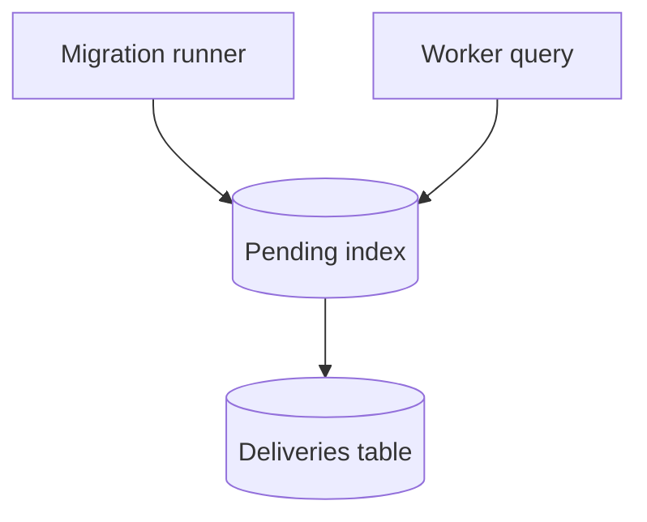

# Raw review — provider: qodo · case 07 · condition A
PR: https://github.com/upreti-labs/run-qodo/pull/7 · base pilot/base · head pilot/07 · status in_progress

## Reviews (verbatim, in order received)

### PR comment by qodo-code-review[bot] · 2026-11-23T13:21:06Z

<h3>PR Summary by Qodo</h3>

Index pending deliveries for due-job lookups


<code>✨ Enhancement</code> <code>🕐 Less than 10 minutes</code>


<details>
<summary>AI Description</summary>

<dl>
<dd>
<br/>

><pre>
>• Add a partial index for undelivered jobs ordered by queue, scheduled time, and ID.
>• Speed up worker lookups without indexing completed deliveries.
></pre>

</dd>
</dl>

</details>

<!-- qodo-describe-risk-slot --><!-- qodo-describe-risk -->
<!-- qodo-describe-risk-start:1795440088.099718094 -->

<details>
<summary>Merge Risk <code>🟢 Low</code></summary>

<dl>
<dd>

<br/>

<details>
<summary>Blast radius <code>🟢 Low</code> <code>💥 1 capability</code></summary>

<dl>
<dd>

<br/>

- 1 affected end-to-end capability after fault-specific containment; implementation boundaries do not widen its functional scope.
- The changed index is consumed by the single worker query that selects undelivered, due rows for a named queue.
- This is one bounded scheduled-report delivery integration; the index is not used by the separately inspected history, export, archive, scheduling, or summary operations.

<details>
<summary>Sources</summary>

<dl>
<dd>

[migrations/002_pending_by_queue.sql\[1-2\]](https://github.com/upreti-labs/run-qodo/blob/68ef658388c5cc9ec890d030918fb6a0b36ea369/migrations/002_pending_by_queue.sql#L1-L2)

```sql
CREATE INDEX deliveries_due_by_queue ON deliveries (queue, scheduled_at, id)
WHERE delivered_at IS NULL;
```

</dd>
</dl>

</details>

</dd>
</dl>

</details>
<details>
<summary>Behavioral complexity <code>🟢 Low</code> <code>🧩 Straightforward</code></summary>

<dl>
<dd>

<br/>

- Before: due-delivery selection scans deliveries using the existing queue, delivered&#95;at, scheduled&#95;at, and id conditions.
- After: migration adds a partial index with exactly those filter/order columns and the delivered&#95;at IS NULL predicate.
- New correctness condition: the index definition must remain semantically equivalent to the worker predicate and be created transactionally.
- This is a direct reuse of existing query conditions, with no newly interacting branches, compatibility states, algorithm, concurrency protocol, or coordinated invariant introduced by the changed SQL.

<details>
<summary>Sources</summary>

<dl>
<dd>

[migrations/002_pending_by_queue.sql\[1-2\]](https://github.com/upreti-labs/run-qodo/blob/68ef658388c5cc9ec890d030918fb6a0b36ea369/migrations/002_pending_by_queue.sql#L1-L2)

```sql
CREATE INDEX deliveries_due_by_queue ON deliveries (queue, scheduled_at, id)
WHERE delivered_at IS NULL;
```

</dd>
</dl>

</details>

</dd>
</dl>

</details>
<details>
<summary>Potential damage <code>🟡 Medium</code> <code>🩹 Temporary loss</code></summary>

<dl>
<dd>

<br/>

- If migration-time index creation fails or blocks the database, the worker invocation may be temporarily unavailable and due reports remain pending rather than being delivered.
- Recovery is expected to require releasing the lock or correcting the database condition and rerunning the migration; reverting application code alone does not necessarily remove an already-created index or repair a failed deployment.
- No persistent delivery-state corruption or external irreversible effect is supported by the inspected code.
- Recoverable after migration retry or operational database recovery.
- A code rollback alone is insufficient if migration 002 has already run, but no delivery rows are changed by the index creation itself.

<details>
<summary>Sources</summary>

<dl>
<dd>

[migrations/002_pending_by_queue.sql\[1-2\]](https://github.com/upreti-labs/run-qodo/blob/68ef658388c5cc9ec890d030918fb6a0b36ea369/migrations/002_pending_by_queue.sql#L1-L2)

```sql
CREATE INDEX deliveries_due_by_queue ON deliveries (queue, scheduled_at, id)
WHERE delivered_at IS NULL;
```

</dd>
</dl>

</details>

</dd>
</dl>

</details>
<sub>Assessed commit <a href="https://github.com/upreti-labs/run-qodo/commit/68ef658388c5cc9ec890d030918fb6a0b36ea369">68ef658</a></sub>


<!-- https://github.com/upreti-labs/run-qodo/commit/68ef658388c5cc9ec890d030918fb6a0b36ea369 -->
</dd>
</dl>
</details>
<!-- /qodo-describe-risk -->

<details>
<summary>Diagram</summary>

<dl>
<dd>

<br/>



</dd>
</dl>

</details>


<details>
<summary>High-Level Assessment</summary>

<dl>
<dd>

<br/>

>The partial index fits the existing worker predicate and ordering while avoiding entries for completed deliveries. A full index was considered but would retain completed rows without benefiting this lookup.

</dd>
</dl>

</details>

<details>
<summary> Files changed (1) <code> +2 / -0 </code> </summary>

<dl>
<dd>

<br/>

<details>
<summary>Enhancement (1) <code> +2 / -0 </code></summary>

<dl>
<dd>

<details>
<summary>002_pending_by_queue.sql<code>Add a partial index for pending deliveries</code> <code>+2/-0</code></summary>

<br/>

>Add a partial index for pending deliveries
>
><pre>
>• Creates an index on queue, scheduled_at, and id for rows where delivered_at is NULL. This supports the worker&#x27;s due-job filter and ordering while excluding completed deliveries.
></pre>
>
><a href='https://github.com/upreti-labs/run-qodo/pull/7/files#diff-7665dc4702d43462b5638457f576de17c89e2b2c6ca05f8652c02251c5ec37be'>migrations/002_pending_by_queue.sql</a>

</details>

</dd>
</dl>

</details>

</dd>
</dl>

</details>

<!-- qodo-describe-head:68ef658388c5cc9ec890d030918fb6a0b36ea369 -->

### PR comment by qodo-code-review[bot] · 2026-11-23T13:21:24Z


<h3>Code Review by Qodo</h3>
<code>🐞 Bugs (0)</code>  <code>📘 Rule violations (0)</code>  <code>📎 Requirement gaps (0)</code>

<br/>


<h3>Great, no issues found!</h3>
Qodo reviewed your code and found no material issues that require review

<br/>


<!-- https://github.com/upreti-labs/run-qodo/commit/68ef658388c5cc9ec890d030918fb6a0b36ea369 -->

<a href="https://www.qodo.ai"></a>
