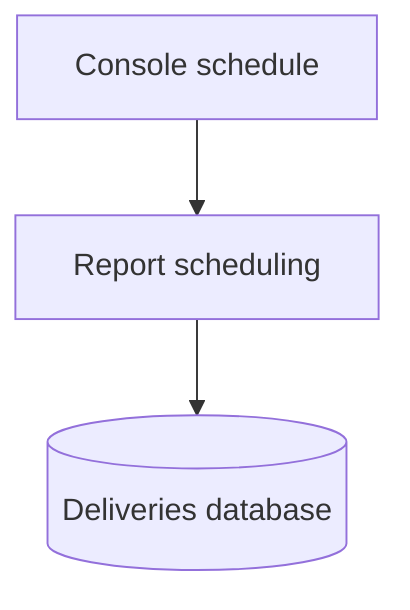

# Raw review — provider: qodo · case 09 · condition A
PR: https://github.com/upreti-labs/run-qodo/pull/12 · base pilot/base · head pilot/09 · status in_progress

## Reviews (verbatim, in order received)

### PR comment by qodo-code-review[bot] · 2026-11-23T14:07:42Z

<h3>PR Summary by Qodo</h3>

Remove the transaction context from report scheduling


<code>✨ Enhancement</code> <code>🕐 Less than 10 minutes</code>


<details>
<summary>AI Description</summary>

<dl>
<dd>
<br/>

><pre>
>• Inserts scheduled deliveries without a transaction context, simplifying the scheduling function.
>• Changes when inserts are committed; the console currently closes its connection without committing
>  them.
></pre>

</dd>
</dl>

</details>

<!-- qodo-describe-risk-slot --><!-- qodo-describe-risk -->
<!-- qodo-describe-risk-start:1795442879.120321989 -->

<details>
<summary>Merge Risk <code>🟡 Medium</code></summary>

<dl>
<dd>

<br/>

<details>
<summary>Blast radius <code>🟡 Medium</code> <code>💥 3 capabilities</code></summary>

<dl>
<dd>

<br/>

- 3 affected capabilities within one bounded functional scope: report&#95;delivery&#95;integration.
- This is the directly changed enqueue behavior.
- The console invokes it for the user-visible schedule operation, and the inserted deliveries table row is the state consumed by the worker and reporting surfaces.
- This is the worker outcome of the same report-delivery integration: deliver&#95;due selects rows from deliveries created by schedule\(\).
- It is a downstream end-to-end behavior, not a separate technical layer.
- These are distinct operator-facing outcomes within the same bounded report-delivery integration.
- Each reads the deliveries state written by schedule\(\), so the changed persistence behavior affects their view of newly scheduled jobs without establishing an independent functional domain.

<details>
<summary>Sources</summary>

<dl>
<dd>

[reports.py\[23-27\]](https://github.com/upreti-labs/run-qodo/blob/c4a7c1df8dc6ac544a352be491e4a980f2e093cc/reports.py#L23-L27)

```python
def schedule(db, report, scheduled_at):
    row = db.execute(
        "INSERT INTO deliveries (report, scheduled_at, queue) VALUES (?, ?, ?)",
        (report, scheduled_at, DELIVERY_QUEUE),
    )
```

</dd>
</dl>

</details>

</dd>
</dl>

</details>
<details>
<summary>Behavioral complexity <code>🟡 Medium</code> <code>🧩 Coordinated invariants</code></summary>

<dl>
<dd>

<br/>

- Before, schedule\(\) executed the INSERT inside <b><i>with db</i></b>, coupling persistence of the delivery row to the successful scheduling operation.
- After, the INSERT occurs outside that transaction context and the function immediately returns the row ID.
- The new correctness condition is that every caller must explicitly commit before connection close, while the caller-visible success result must continue to correspond to durable enqueue state.
- The shipped console does not establish that condition.
- This is a changed persistence/result invariant, not merely routine use of an existing database helper.

<details>
<summary>Sources</summary>

<dl>
<dd>

[reports.py\[23-27\]](https://github.com/upreti-labs/run-qodo/blob/c4a7c1df8dc6ac544a352be491e4a980f2e093cc/reports.py#L23-L27)

```python
def schedule(db, report, scheduled_at):
    row = db.execute(
        "INSERT INTO deliveries (report, scheduled_at, queue) VALUES (?, ?, ?)",
        (report, scheduled_at, DELIVERY_QUEUE),
    )
```

</dd>
</dl>

</details>

</dd>
</dl>

</details>
<details>
<summary>Potential damage <code>🟡 Medium</code> <code>🩹 Temporary loss</code></summary>

<dl>
<dd>

<br/>

- The scheduling operation appears successful but does not durably enqueue the requested job on the shipped console path.
- Reverting the code restores the transaction boundary, but jobs already reported as scheduled are not recoverable from the database and must be identified and resubmitted.
- No external delivery or receipt is created before the rollback.
- Business criticality uses the equal-importance baseline because no capability-specific declaration was supplied.
- Recoverable by deploying the transaction fix and manually rescheduling affected requests.
- Recovery requires identifying which successful-looking schedule commands occurred during the faulty version; code rollback alone does not recreate missing rows.

<details>
<summary>Sources</summary>

<dl>
<dd>

[reports.py\[23-27\]](https://github.com/upreti-labs/run-qodo/blob/c4a7c1df8dc6ac544a352be491e4a980f2e093cc/reports.py#L23-L27)

```python
def schedule(db, report, scheduled_at):
    row = db.execute(
        "INSERT INTO deliveries (report, scheduled_at, queue) VALUES (?, ?, ?)",
        (report, scheduled_at, DELIVERY_QUEUE),
    )
```

</dd>
</dl>

</details>

</dd>
</dl>

</details>
<sub>Assessed commit <a href="https://github.com/upreti-labs/run-qodo/commit/c4a7c1df8dc6ac544a352be491e4a980f2e093cc">c4a7c1d</a></sub>


<!-- https://github.com/upreti-labs/run-qodo/commit/c4a7c1df8dc6ac544a352be491e4a980f2e093cc -->
</dd>
</dl>
</details>
<!-- /qodo-describe-risk -->

<details>
<summary>Diagram</summary>

<dl>
<dd>

<br/>



</dd>
</dl>

</details>


<details>
<summary>High-Level Assessment</summary>

<dl>
<dd>

<br/>

>The following are alternative approaches to this PR:

<details>
<summary><b>1. Retain the transaction context</b></summary>

<dl>
<dd>

- ➕ Commits the insert for existing console callers.
- ➖ Keeps transaction ownership inside the scheduling function.

</dd>
</dl>

</details>

<details>
<summary><b>2. Make callers own the transaction</b></summary>

<dl>
<dd>

- ➕ Lets callers group scheduling with other database operations.
- ➖ Requires updating the console and every other caller to commit explicitly.

</dd>
</dl>

</details>

>**Recommendation:** Retain `with db` for this PR. SQLite implicitly starts a transaction for the insert, and `console.py` closes the connection without committing; removing the context can therefore discard scheduled deliveries. If caller-owned transactions are the goal, update callers as part of the change.

</dd>
</dl>

</details>

<details>
<summary> Files changed (1) <code> +4 / -5 </code> </summary>

<dl>
<dd>

<br/>

<details>
<summary>Refactor (1) <code> +4 / -5 </code></summary>

<dl>
<dd>

<details>
<summary>reports.py<code>Remove the transaction context around delivery insertion</code> <code>+4/-5</code></summary>

<br/>

>Remove the transaction context around delivery insertion
>
><pre>
>• The scheduling function now executes its INSERT directly and still returns the new row ID. It no longer commits that insert through the connection context manager.
></pre>
>
><a href='https://github.com/upreti-labs/run-qodo/pull/12/files#diff-e09e5408424977efcb04ce4dbf13638058e35f4afb681306bae14985c656d126'>reports.py</a>

</details>

</dd>
</dl>

</details>

</dd>
</dl>

</details>

<!-- qodo-describe-head:c4a7c1df8dc6ac544a352be491e4a980f2e093cc -->

### PR comment by qodo-code-review[bot] · 2026-11-23T14:07:51Z

<h3>Code Review by Qodo</h3>

<br/>


<details>
<summary>  1.  Scheduled reports are silently never saved <code>🐞 Bug</code></summary>

<br/>

> <details>
><summary>Description</summary>
><br/>
>
><pre>
><b><i>schedule</i></b> now runs the INSERT with no commit, because the <b><i>with db:</i></b> block that committed it was
>removed, so the sqlite3 module leaves the insert in an open implicit transaction. The <b><i>schedule</i></b>
>command in <b><i>console.py</i></b> then closes the connection through <b><i>closing()</i></b> without committing, so the
>uncommitted row is rolled back and the command still prints a row id as if it succeeded.
></pre>
></details>

> <details>
><summary>Agent prompt</summary>
><br/>
>
>```
>The issue below was found during a code review. Follow the provided context and guidance below and implement a solution
>
>Issue description
>The `schedule` function in `reports.py` executes an INSERT without committing. Python's sqlite3 connection keeps it in an open implicit transaction, and the CLI in `console.py` closes the connection without committing, so the scheduled delivery is lost while the command reports a row id.
>
>Fix Focus Areas
>- reports.py[23-28]
>- console.py[30-33]
>
>Recommended Fix
>Keep the commit in `schedule`. Either restore `with db:` around the INSERT (the connection context manager commits on success and rolls back on exception), or call `db.commit()` after `execute`. Do not remove the commit to simplify the code; the transaction handling is required for sqlite3's legacy implicit-transaction mode. Add a test that schedules a report through the CLI and then reopens the database to confirm the row exists.
>```
> <code>ⓘ Copy this prompt and use it to remediate the issue with your preferred AI generation tools</code>
></details>

[Dismiss ↗](https://app.qodo.ai/findings/1916bd32-27f0-47f4-be78-971ec75d5968?action=dismiss&origin=git) | [View ↗](https://app.qodo.ai/findings/1916bd32-27f0-47f4-be78-971ec75d5968)

</details>


<br/>

<!-- qodo-self-review-slot -->
<!-- https://github.com/upreti-labs/run-qodo/commit/c4a7c1df8dc6ac544a352be491e4a980f2e093cc -->

